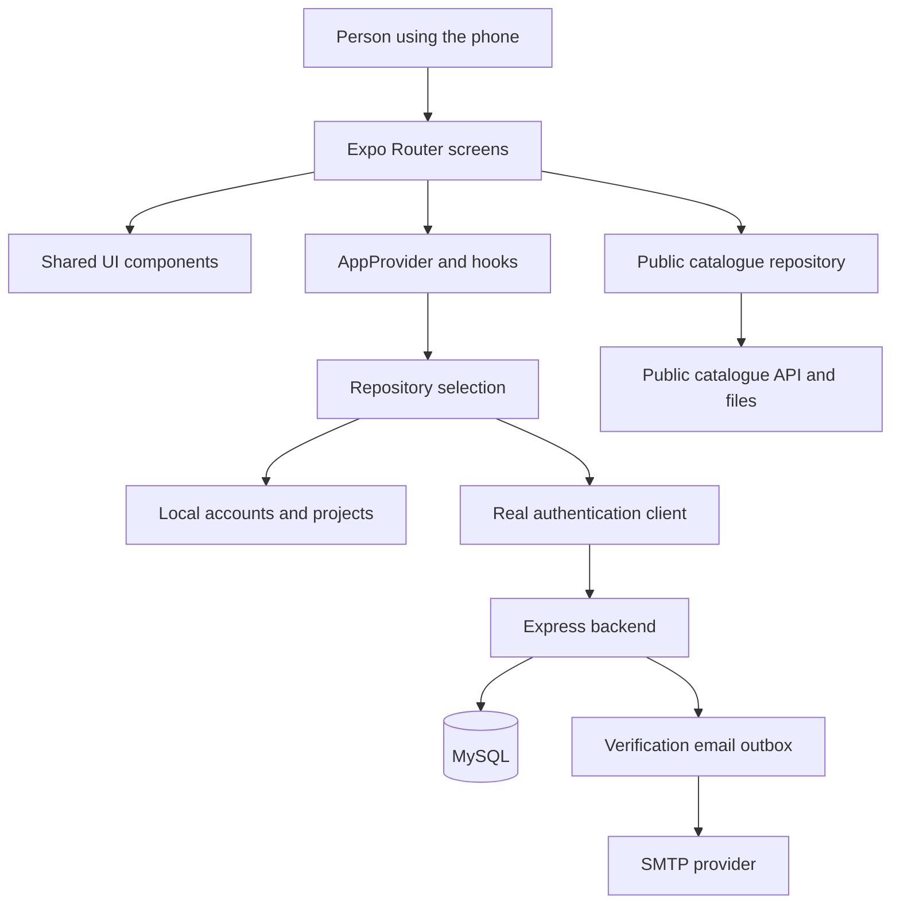
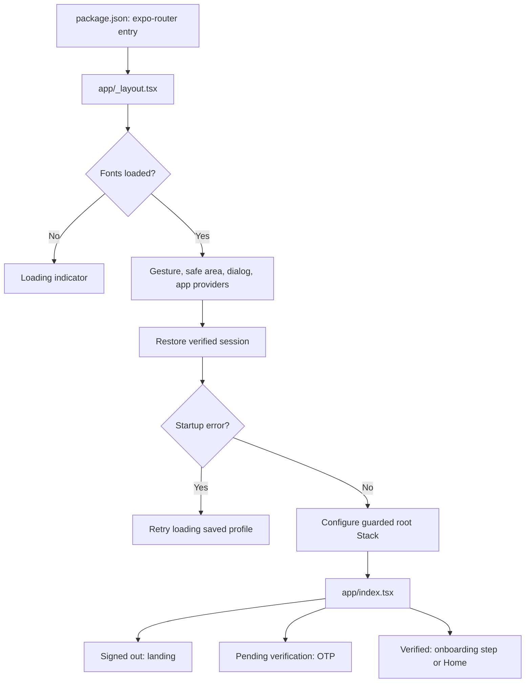
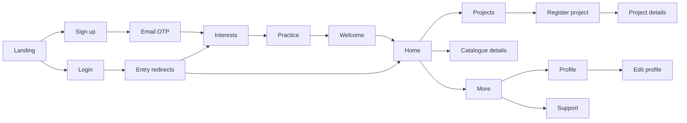
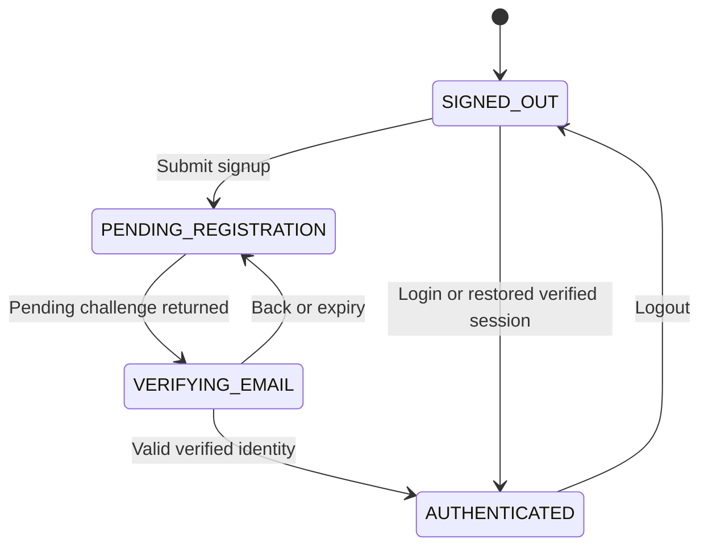
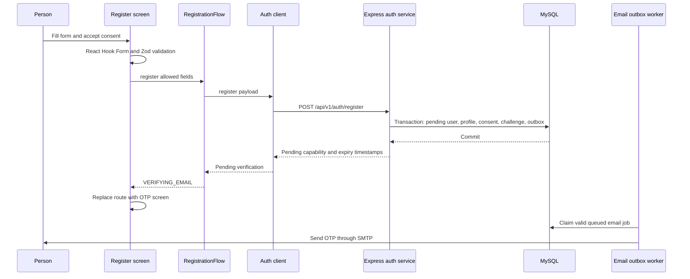
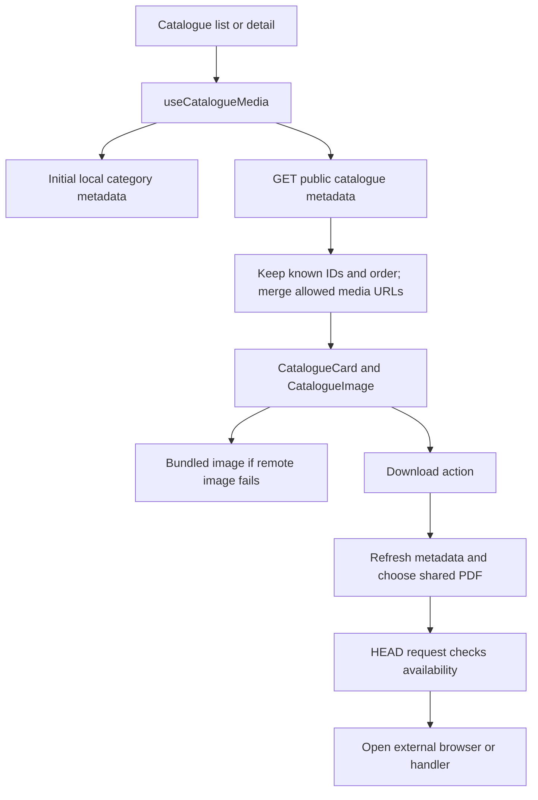
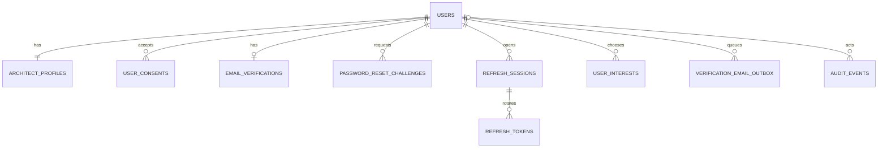

# APP explain — INOX, from your first line of JavaScript to the complete app

> A beginner's handbook for this repository. Read from top to bottom if you have never used Node.js, React, or React Native. Use the contents and file atlas when you return to make a change.
>
> Repository snapshot: **15 October 2026**. This document describes the code that exists, including its unfinished parts. Examples marked **learning example** explain an idea; they are not changes made to the application.

## Contents

1. [What the app does](#1-what-the-app-does)
2. [The whole system in one picture](#2-the-whole-system-in-one-picture)
3. [The tools, in everyday language](#3-the-tools-in-everyday-language)
4. [JavaScript and TypeScript from zero](#4-javascript-and-typescript-from-zero)
5. [React: why it exists and how it works](#5-react-why-it-exists-and-how-it-works)
6. [React Native: turning React into a mobile app](#6-react-native-turning-react-into-a-mobile-app)
7. [How this app starts](#7-how-this-app-starts)
8. [Every screen and how navigation connects them](#8-every-screen-and-how-navigation-connects-them)
9. [Shared components and visual design](#9-shared-components-and-visual-design)
10. [State, hooks, and the registration controller](#10-state-hooks-and-the-registration-controller)
11. [Repositories, services, and data shapes](#11-repositories-services-and-data-shapes)
12. [Signup, OTP, login, refresh, and logout](#12-signup-otp-login-refresh-and-logout)
13. [Onboarding and editing a profile](#13-onboarding-and-editing-a-profile)
14. [Projects and selected documents](#14-projects-and-selected-documents)
15. [Catalogues, images, and the shared PDF](#15-catalogues-images-and-the-shared-pdf)
16. [Dashboard, rewards, support, and policy content](#16-dashboard-rewards-support-and-policy-content)
17. [The Node.js backend](#17-the-nodejs-backend)
18. [MySQL and migrations](#18-mysql-and-migrations)
19. [Security explained without mystery](#19-security-explained-without-mystery)
20. [Configuration and environment variables](#20-configuration-and-environment-variables)
21. [Running the app for the first time](#21-running-the-app-for-the-first-time)
22. [Testing and understanding errors](#22-testing-and-understanding-errors)
23. [Builds, releases, and updates](#23-builds-releases-and-updates)
24. [Performance, accessibility, and mobile behavior](#24-performance-accessibility-and-mobile-behavior)
25. [Where future features belong](#25-where-future-features-belong)
26. [A practical learning path](#26-a-practical-learning-path)
27. [Glossary](#27-glossary)
28. [Official references](#28-official-references)
29. [Complete source file atlas](#29-complete-source-file-atlas)
30. [Documentation checks](#30-documentation-checks)

### How to view the pictures

Open this file in a Markdown preview. Mermaid-capable viewers render the diagram blocks as graphics. Plain text diagrams and tables remain readable without Mermaid. The visuals are inside this single Markdown file; there are no additional generated image files or remote diagram dependencies.

### Scope of the reading

The review covered application and backend source, tests, migrations, existing documentation, configuration, and the native Android source/configuration. Installed dependencies, generated compilation/cache trees, archives, signing material, and compiled application binaries are explained by purpose rather than reproduced as source lessons. Actual secret values from local environment files are deliberately not copied here. This is a detailed guide to the app and the concepts it uses, not a claim to contain every API in the JavaScript ecosystem.

## 1. What the app does

INOX is an application for architects and designers. It introduces product categories, lets a person create an account, verifies their email, collects professional preferences, displays a dashboard, and lets them maintain projects on their device.

Think of the app as a professional club reception desk:

| Everyday action | App equivalent |
|---|---|
| Enter the reception | Landing screen |
| Fill out a membership form | Register |
| Prove you control your email address | Email OTP verification |
| Tell the club what you work on | Interests and practice onboarding |
| View your member record | Profile |
| Keep a list of jobs | Projects |
| Browse product brochures | Catalogues |
| Ask for assistance | Support screens |

### What is working, local, or unfinished?

| Area | What the checked source currently does |
|---|---|
| Authentication in `mock` mode | Creates device-local accounts after development OTP verification. No real email is sent. |
| Authentication in `real` mode | Calls the included Express/MySQL authentication backend. Requires a configured, reachable backend. |
| Professional profile and onboarding | Local persistence in mock mode; backend persistence in real mode. |
| Email verification | Distinct from professional architect verification. Verifying an email does not approve someone as an architect. |
| Projects | Device-local AsyncStorage in both modes; initial sample projects are returned when no saved collection exists. |
| Project documents | Selects a file and stores its metadata/URI with the local project. No server upload endpoint is implemented. |
| Catalogue metadata and media | Public backend routes can supply current media; app retains local catalogue metadata and image fallbacks. |
| PDF action | Refreshes metadata, checks a PDF URL, and opens the browser/handler. Does not implement an in-app offline PDF download library. |
| Dashboard points, tier, targets, campaign | Temporary presentation values from a local object. Not a real wallet or redemption ledger. |
| Rewards screen | Coming-soon placeholder. |
| Support messages in mock mode | Simulated completion; the mock method does not actually persist or deliver a message. |
| Support in real mode | Frontend request methods exist, but the supplied backend does not mount those help/ticket endpoints. |
| Chat, notifications, password-change UI | Unavailable/placeholder actions. Backend password reset endpoints exist, but the reset screen/link handler is missing. |

**Important:** a screen looking finished does not prove that its business workflow is implemented. Read the repository and backend route together before relying on a feature.

## 2. The whole system in one picture

```text
PERSON
  | taps / types / swipes
  v
MOBILE APP                         SERVER
Screens in app/                   backend/src/
  |                                 |
Reusable components                Express HTTP routes
  |                                 |
State and hooks                    Validation + authentication
  |                                 |
Repository interface ---- HTTP ---> Business services
  |                                 |            |
  +--> Device storage               MySQL        SMTP email
  |
  +--> Public catalogue HTTP ------> Allowed images + PDF
```



The **frontend** is what the person sees and touches. The **backend** is the server that checks identities and saves shared records. The **database** holds structured records. SMTP delivers email through a mail provider. Each part has a different job; running the frontend does not automatically start the backend or install MySQL.

### The folder map

```text
INOX-trial/
├── package.json             Mobile dependencies, scripts, active entry
├── app.json                 Expo application identity and native configuration
├── app.config.ts            Adds environment-driven config to app.json
├── eas.json                 Cloud build profiles
├── app/                     Actual current screen directory
│   ├── _layout.tsx          Providers, fonts, guarded root stack
│   ├── index.tsx            Landing page and entry redirects
│   ├── auth/                Login, signup, email OTP
│   ├── onboarding/          Interests, practice, welcome
│   ├── (tabs)/              Main navigation screens
│   ├── profile.tsx          Profile display
│   ├── profile/edit.tsx     Profile form
│   ├── project/[id].tsx     One project
│   ├── catalogue/[id].tsx   One catalogue
│   └── support...           Support overview, article, contact
├── src/
│   ├── components/          Reusable visual building blocks
│   ├── config/              API configuration and environment reading
│   ├── data/                Local choices, copy, sample presentation
│   ├── hooks/               Reusable React lifecycle/data behavior
│   ├── repositories/        Local/remote data access implementations
│   ├── schemas/             Frontend validation rules
│   ├── services/            HTTP, credential storage, PDF opening
│   ├── state/               Shared session and registration flow
│   ├── theme/               Colors, fonts, spacing, corner radii
│   ├── types/               Shared TypeScript data contracts
│   └── utils/               Small calculations and pure helpers
├── assets/                  Bundled app images and icons
├── tests/                   Navigation behavior/source checks
├── backend/                 Separate Node.js server package
│   ├── src/                 Server source
│   ├── migrations/          Ordered SQL schema changes
│   ├── scripts/             Migration, diagnosis, cleanup, smoke helpers
│   ├── tests/               Backend and frontend integration checks
│   └── public/catalogues/   Public allowlisted catalogue files
├── android/                 Existing generated/native Android project
└── release-audit/           Historical release inspection artifacts
```

The repository's `AGENTS.md` mentions `src/app/`. **This checkout actually uses root `app/`.** The documentation follows the files that exist. Do not create a second route tree just to match a generic instruction. The `@/` import alias points at `src/`, not the route directory.

## 3. The tools, in everyday language

| Tool | Plain meaning | Why it is here | Where you reuse it |
|---|---|---|---|
| JavaScript | Programming language for behavior | Handles taps, values, calculations, requests | Web apps, mobile apps, servers |
| TypeScript | JavaScript with development-time type checks | Catches wrong shapes/arguments before running | Larger apps and shared contracts |
| React | Builds UI from components and changing state | Keeps interface code organized | Web interfaces and React Native |
| React Native | React renderer and native mobile components | Produces Android/iOS interfaces | Cross-platform mobile products |
| Expo | React Native framework, tools, modules | Development, device APIs, configuration, builds | New mobile apps with native capabilities |
| Expo Router | Screen navigation derived from files | Maps route files to destinations | Apps with login flows, tabs, detail screens |
| Node.js | Runs JavaScript outside a browser | Runs development tools and this backend | APIs, command-line tools, workers |
| npm | Package manager and script runner | Installs project dependencies and runs scripts | Most Node-based projects |
| Metro | Bundler/development server used by Expo | Prepares application modules/assets for the app | React Native development |
| Express | HTTP server routing library | Implements the backend API | Authentication and business APIs |
| MySQL | Relational database | Durable identities, profiles, sessions, challenges | Data shared between devices/users |
| EAS | Expo Application Services | Cloud builds, submission, compatible updates | Sharing and releasing native apps |

**Node.js is not React.** Node runs tooling on your computer and the backend on a server. The installed mobile application runs JavaScript in its mobile runtime; it does not require the user to install Node.js on their phone.

### Versions recorded in this repository

From root `package.json`: Expo `~57.0.27`, React `19.2.3`, React Native `0.86.3`, Expo Router `~57.0.25`, and TypeScript `~6.0.3`. From `backend/package.json`: Node engine `>=24.6.0 <25`, Express `^5.2.1`, mysql2 `^3.24.5`, and Zod `^4.6.5`.

These are declared version ranges; a lockfile resolves exact installed versions. `~57.0.27` allows compatible patch changes within that minor range; `^5.2.1` allows a wider compatible range below the next major version. Read the lockfile/package installation when diagnosing an exact version issue.

There is a root npm lockfile and no root `bun.lock` in the inspected snapshot, so examples use npm/npx. Follow `AGENTS.md` and use `bunx` if a future checkout uses Bun. Check the matching [Expo SDK 57 reference](https://docs.expo.dev/versions/v57.0.0/) before changing Expo APIs.

## 4. JavaScript and TypeScript from zero

### 4.1 Values, variables, and objects

A value is a piece of information. A variable gives it a name.

```ts
// Learning example
const firstName = 'Asha';          // string: text
let selectedCount = 0;            // number; let allows reassignment
const verified = false;           // boolean: true/false
const user = { firstName, verified }; // object: named properties
const interests = ['kitchen', 'wardrobe']; // array: ordered collection
```

`const` prevents reassignment of the variable. It does not deeply freeze an object. `user.firstName` reads a property. `interests[0]` reads the first array entry; array indexes start at zero.

`null` normally means an intentionally absent value, such as a signed-out user. `undefined` often means not supplied/not loaded. The project detail screen uses an undefined item while loading and `null` when the requested project is absent.

### 4.2 Functions and callbacks

A function is a named operation. Arguments are inputs; a return value is the output.

```ts
// Learning example
function fullName(first: string, last: string) {
  return `${first} ${last}`;
}
const name = fullName('Asha', 'Rao');
const greet = () => fullName('Asha', 'Rao');
```

The arrow function `() => ...` is another way to define a function. A **callback** is a function handed to something else to call later. `onPress={submit}` passes the function; `onPress={submit()}` executes it immediately while rendering and usually supplies the wrong value.

### 4.3 Everyday syntax found throughout this code

| Syntax | Meaning | Example in this app's patterns |
|---|---|---|
| `===` | Strict equality | `phase === 'AUTHENTICATED'` |
| `!==` | Not equal | Ignore a different user ID |
| `&&` | Both conditions; also conditional rendering | Show an error only when present |
| `||` | First truthy value | Display a fallback label for empty text |
| `??` | Fallback only for null/undefined | `user?.interests ?? []` |
| `?.` | Read/call only if the left side exists | `user?.firstName` |
| `condition ? a : b` | Choose one value | Loading label versus normal label |
| `...object` | Copy/spread properties | Update a state snapshot |
| `...array` | Copy/spread array items | Add a selected interest |
| `{ firstName } = user` | Destructure a property | Read several context values |
| `[value, setter] = ...` | Destructure array positions | `useState` |
| Backtick strings | Text with `${expression}` inserted | A dynamic detail URL |
| `!value` | Boolean negation | Deny access when not authenticated |
| `value!` in TypeScript | Assert non-null to the typechecker | Only justified after a real guard |
| `void promiseCall()` | Deliberately ignore its result | Event starts async work; still handle errors |

### 4.4 Arrays: map, filter, find, reduce, and sort

```ts
// Learning example
const chosen = ['kitchen', 'wardrobe'];
const labels = chosen.map(id => id.toUpperCase()); // transform every item
const removed = chosen.filter(id => id !== 'kitchen'); // retain matches
const found = chosen.find(id => id === 'wardrobe'); // first match or undefined
const total = [100, 200].reduce((sum, value) => sum + value, 0);
```

The interest grid uses `map`. Project filters use `filter`. Detail lookup uses `find`. Dashboard totals use `reduce`. The summary helper copies projects before sorting because `.sort()` changes the original array.

### 4.5 Modules and imports

Each source file is a module. `export` makes a value available elsewhere. `import` brings it into another file.

```ts
import { colors } from '@/theme/tokens'; // named export; @ means src/
import type { User } from '@/types/api'; // development-time type only
```

`export default` is the module's default export; route files use it for their screen. A relative import such as `../utils/onboarding` walks from the importing file. An alias import starts from its configured base.

### 4.6 Async code, promises, and failure

Reading storage or contacting a server takes time. A Promise represents an operation that will finish later. `await` waits inside an async function without synchronously freezing JavaScript while the external work happens.

```ts
// Learning example
async function loadProjects() {
  try {
    const projects = await repositories.projects.list();
    return projects;
  } catch (error) {
    throw new Error('Could not load projects.');
  } finally {
    // Release a lock or stop a loading indicator here.
  }
}
```

`try` runs the operation, `catch` handles failure, and `finally` runs after success or failure. `Promise.all` combines independent work and rejects if one rejects. `Promise.allSettled` reports all outcomes; logout uses it so cleanup can account for an operation already in progress.

An `AbortController` can request cancellation of fetch work. Cancellation alone is insufficient: some work may finish anyway. This app also compares session generations and checks screen focus before accepting late results.

### 4.7 TypeScript vocabulary

```ts
// Learning example
type Status = 'loading' | 'ready' | 'error';
type CardProps = { title: string; subtitle?: string };
interface ProjectSource { list(): Promise<Project[]> }
```

A **type** describes allowed values. A union (`|`) allows one of several possibilities. `?` makes a property optional. An interface describes a contract an implementation must satisfy. A generic (`Promise<T>`, `HomeResource<T>`) reuses one structure with different item types.

`Partial<T>` makes properties optional, `Pick<T, K>` keeps selected fields, and `Omit<T, K>` removes selected fields. For example, `CreateProjectInput` omits server/generated-style fields from `Project`, while a registration draft excludes password and registration token.

**Types do not validate network data at runtime.** Type annotations are removed when code is compiled. Zod validation and explicit response checks are needed for values from users, files, storage, and HTTP.

## 5. React: why it exists and how it works

Without a UI library, every change can require manual work: find the text label, replace its contents, hide a spinner, show an error, update a badge, and remember every affected place. React lets you describe the interface for the current state. When state changes, React calls component functions again and updates the rendered output as needed.

```text
Current data + component functions
                |
                v
        Description of the UI
                |
                v
      Renderer updates the screen

User event --> state update --> render again --> updated screen
```

React's component/state model is described in the [official React introduction](https://react.dev/learn). The following examples apply that model to mobile primitives rather than browser HTML.

### 5.1 Components

A component is a reusable UI function. It may be small, such as a button, or large, such as the Home screen.

```tsx
// Learning example
function Greeting({ name }: { name: string }) {
  return <Text>Hello, {name}</Text>;
}
```

`Greeting` is the component. `<Greeting name="Asha" />` uses it. The supplied `name` is a **prop**: an input from its parent. Component names start with uppercase letters.

### 5.2 JSX and TSX

JSX is the tag-like syntax inside JavaScript. `.tsx` means TypeScript with JSX. It describes elements; it is not a literal Android XML file or an HTML document. Curly braces insert a JavaScript expression: `<Text>{user.firstName}</Text>`.

Close every tag. Return one enclosing element or a fragment `<>...</>`. A fragment groups elements without adding a visible native container.

### 5.3 Props, children, and composition

Props go from parent to child. Children are the content nested inside a component.

```tsx
// Learning example
<Card>
  <Title>My projects</Title>
  <ProjectCard project={project} />
</Card>
```

`Card` controls the shared surface; `ProjectCard` controls project content. Composition lets new screens reuse the same pieces. You will use it in product lists, account pages, checkout forms, chat bubbles, and settings.

### 5.4 State is component memory

```tsx
// Learning example
function Counter() {
  const [count, setCount] = React.useState(0);
  return <Pressable onPress={() => setCount(value => value + 1)}>
    <Text>{count}</Text>
  </Pressable>;
}
```

`count` is the current render's value. `setCount` schedules a state update. A plain local variable does not persist as reactive component memory between renders.

State updates are not an instruction to immediately change the variable already captured by the current function. Use the updater form when the next state depends on the previous state. Keep arrays and objects immutable: make new values with spreads, `map`, or `filter` rather than mutating existing React state.

### 5.5 Rendering, reconciliation, and keys

Rendering means evaluating components to describe UI. Committing means applying changes through the renderer. React compares element identity and structure to decide what to preserve or update. A render does not necessarily recreate every native view.

For a list, `key={item.id}` gives stable identity among siblings. Random keys or unstable array indexes can make React lose the connection between an item and its previous UI/state when items move.

Keep render logic pure: calculating labels is appropriate; starting network requests, writing storage, and setting intervals during every render is not. Use handlers or effects for those external actions.

### 5.6 Hooks: the ones this repository uses

| Hook | What it does | Example here | Future use |
|---|---|---|---|
| `useState` | Stores a reactive value | Form visibility, loading, selected interests | Any interactive control |
| `useEffect` | Synchronizes with an external system after render | Timers, native event listeners, initial bootstrap | Subscriptions and non-focus lifecycle work |
| `useRef` | Keeps a mutable value without causing a render | Input references, immediate submit locks | Focus controls and request ownership |
| `useMemo` | Reuses a calculated value while dependencies match | Project totals/filter results, context value | Expensive derived calculations |
| `useCallback` | Reuses a function identity while dependencies match | Focus callbacks and card handlers | Stable callbacks passed to children/hooks |
| `useContext` | Reads shared provider data | `useAppState`, dialog access, swipe enablement | Auth, theme, app settings |
| `useSyncExternalStore` | Subscribes React to an external state store | `RegistrationFlow` snapshot | Stores/controllers that manage state outside React |
| `useFocusEffect` | Runs work when a route is focused and cleans up on blur | Reload profile/projects | Screens retained in a navigator |
| `useWindowDimensions` | Reads reactive screen dimensions/font scale | Dashboard/profile layout | Phone/tablet adaptation |
| `useForm`, `useWatch` | Manage/watch form values via React Hook Form | Signup/profile/contact | Larger validated forms |

Call hooks at the top level of a component or custom hook, in the same order on every render. Do not call them inside loops, conditions, or ordinary event handlers.

### 5.7 Effect cleanup and dependency arrays

```tsx
// Learning example
React.useEffect(() => {
  const timer = setInterval(() => refresh(), 1000);
  return () => clearInterval(timer);
}, [refresh]);
```

The return function cleans up the previous effect before it is replaced and when the component unmounts. Dependencies tell React which captured values affect the effect. Empty `[]` means no reactive dependencies, not permission to use changing values without accounting for them.

An old callback can retain old values: this is a **stale closure**. A request can also complete after a screen loses focus. This app uses active flags, refs, generation counters, and owner IDs to avoid accepting stale work.

### 5.8 Context and providers

The root provider makes shared user/session actions available below it. `useAppState()` reads that shared context. It throws if called outside `AppProvider`, because there is no valid shared session there.

Context reduces repeated prop passing through unrelated intermediate components. It is not a database and does not automatically persist values across app restarts.

### 5.9 Memoization is an optimization

`memo(CatalogueCard)` can skip a component render when its props compare unchanged. `useMemo` and `useCallback` can reduce repeated work or changing identities. They do not save data permanently and should not carry business correctness. Measure performance before adding them everywhere.

### 5.10 Controlled inputs and form validation

A controlled input receives its displayed value from React/form state and reports edits through a callback:

```tsx
// Learning example inside a component
const [email, setEmail] = React.useState('');
// In the component's returned UI:
<TextInput value={email} onChangeText={setEmail} />
```

Typing calls `onChangeText`; the setter updates state; the next render supplies the new value. The input and your program now agree about the current text. The login screen uses this straightforward pattern.

The larger forms use React Hook Form. `useForm` creates form control/submission helpers; `Controller` connects the shared `Field` to that form's value, change callback, and field error. `zodResolver` connects the Zod schema to validation. `handleSubmit` runs the valid-submit callback only when the form passes its configured rules. `useWatch` reads selected form fields for related UI without maintaining a separate competing copy.

A client field error helps the person correct input. A server field error is still necessary because another program can call the API directly. A submission lock prevents accidental overlapping requests; it does not make a server write transactional. Each layer solves a different problem.

## 6. React Native: turning React into a mobile app

React defines the component model. React Native provides the mobile renderer and components. A web React renderer uses HTML elements; this app uses native components. See the [React Native component explanation](https://reactnative.dev/docs/intro-react-native-components).

| Mobile component | Meaning | Web analogy, only for understanding |
|---|---|---|
| `View` | Layout container | `div` |
| `Text` | Visible text | Text elements such as `p`/`span` |
| `TextInput` | Editable input | `input`/`textarea` |
| `Pressable` | Responds to touch/press | A button-like interaction |
| `Image` | Bundled or remote image | `img` |
| `ScrollView` | Scrollable content rendered together | Scrollable container |
| `FlatList` | Windowed list for larger repeated data | Virtualized list |
| `SectionList` | Grouped/windowed list | Grouped list |
| `Modal` | UI over the current screen | Dialog overlay |
| `ActivityIndicator` | Loading spinner | Loading indicator |

Put ordinary visible text inside `Text`. Do not paste browser tags such as `<div>` into native screens. Similar ideas do not mean identical platform APIs.

### 6.1 Styling

Styles are JavaScript objects. Property names use camelCase, such as `backgroundColor`. An array of styles combines conditions; later entries override earlier properties.

```tsx
// Learning example
<View style={[styles.card, selected && styles.active]} />
```

`padding` is space inside a box; `margin` is space outside. `borderRadius` rounds corners. `gap` spaces children in a layout. Absolute positioning takes an element out of normal layout and places it relative to its containing layout box. It is useful for overlays but easy to misuse on different screen sizes.

### 6.2 Flexbox and dimensions

`flex: 1` lets a component grow into available space. `flexDirection: 'row'` arranges children horizontally. Native's default main direction is column. `justifyContent` aligns along the main axis; `alignItems` aligns across it. The meaning changes when the direction changes.

```text
column                              row
┌──────────────┐                    ┌─────────────────────┐
│    child A   │                    │ child A │ child B   │
│    child B   │                    └─────────────────────┘
└──────────────┘
main axis: vertical                 main axis: horizontal
```

Numeric style sizes are layout units, not a guarantee of physical screen pixels. Avoid designing for only one device width. The app reads width and font scale to rearrange some dashboard/profile sections.

### 6.3 Device details

Safe-area wrappers keep content away from notches and system bars. `KeyboardAvoidingView` helps inputs remain usable with the keyboard visible. `Platform.OS` selects platform-specific behavior. A navigation screen may remain mounted while another screen is focused, which is why focus hooks matter.

The project uses icons from `lucide-react-native`, vector illustrations through `react-native-svg`, and bundled images through static `require(...)`. A remote image uses `{ uri: url }`. Setting a local URI in a record does not upload or permanently copy its file.

## 7. How this app starts

### 7.1 The active entry is defined by package.json

Root `package.json` contains:

```json
"main": "expo-router/entry"
```

This means Expo Router owns startup. The meaningful application root is `app/_layout.tsx`. The root `App.tsx` and `index.ts` are leftover template-style entry files and are not the normal entry for the configured Router app. Changing the starter text in `App.tsx` will not change the current landing screen.

### 7.2 Startup order



### 7.3 The provider tree

```text
GestureHandlerRootView
└── SafeAreaProvider
    └── DialogProvider
        └── AppProvider
            ├── StatusBar
            └── AuthNavigator / Stack
                └── Current screen
```

Each wrapper provides a capability to descendants: native gestures, safe-area measurements, shared dialogs, shared user/session state. Fonts are loaded before the full tree is displayed. `AuthNavigator` handles bootstrap loading/error states and uses `canAccessProtected` to guard authenticated destinations.

### 7.4 Landing behavior

`app/index.tsx` displays introductory benefits and a three-image horizontal carousel for signed-out people. An interval advances the carousel every three seconds and is cleared on cleanup. Its `FlatList` uses known item widths and small render windows. The landing screen also acts as a routing decision point: pending OTP goes to verification; a verified user resumes their saved onboarding stage or opens Home.

## 8. Every screen and how navigation connects them

Expo Router derives routes from files; [the official Router guide](https://docs.expo.dev/router/introduction/) explains the convention. `_layout.tsx` configures how child routes are displayed. A route group such as `(tabs)` organizes navigation without adding that group name to the public URL. A bracket segment such as `[id]` matches a variable part of the path.

### 8.1 Screen directory

| Source file | Destination | Main responsibility |
|---|---|---|
| `app/index.tsx` | `/` | Landing carousel and session/onboarding redirects |
| `app/auth/login.tsx` | `/auth/login` | Email/password login and errors |
| `app/auth/register.tsx` | `/auth/register` | Validated registration, consent, account-conflict dialog |
| `app/auth/verify-email.tsx` | `/auth/verify-email` | Six OTP cells, paste, countdown, resend, cancellation |
| `app/onboarding/interests.tsx` | `/onboarding/interests` | Up to three interest selections and durable advancement |
| `app/onboarding/practice.tsx` | `/onboarding/practice` | Practice type and team size |
| `app/onboarding/welcome.tsx` | `/onboarding/welcome` | Account summary and completion action |
| `app/(tabs)/home.tsx` | `/home` | Dashboard composition, projects, catalogues |
| `app/(tabs)/projects.tsx` | `/projects` | Project list, filters, search, summary |
| `app/(tabs)/register-project.tsx` | `/register-project` | Local project form and document selection |
| `app/(tabs)/points.tsx` | `/points` | Rewards placeholder |
| `app/(tabs)/more.tsx` | `/more` | Catalogue, profile, support links |
| `app/(tabs)/catalogues.tsx` | `/catalogues` | Catalogue card list |
| `app/profile.tsx` | `/profile` | Identity, firm information, settings, logout |
| `app/profile/edit.tsx` | `/profile/edit` | Validated editable profile fields |
| `app/project/[id].tsx` | `/project/orion`, for example | Loads and displays one project |
| `app/catalogue/[id].tsx` | `/catalogue/kitchen`, for example | Product media and shared PDF action |
| `app/support.tsx` | `/support` | Help search, quick contact actions, ticket display |
| `app/support/article.tsx` | `/support/article?id=...` | One local help article |
| `app/support/contact.tsx` | `/support/contact` | Validated contact form |

In source, calls often include the group, for example `/(tabs)/home`, to identify the intended destination unambiguously.

### 8.2 Screen journey



### 8.3 Navigation methods

| API | Meaning | Appropriate use |
|---|---|---|
| `router.push(...)` | Put a destination on history | Open details and allow Back |
| `router.replace(...)` | Replace current history entry | Leave a completed auth/form step |
| `router.navigate(...)` | Navigate with navigator-aware behavior | Select an existing tab/destination |
| `router.back()` | Return through available history | Back button |
| `router.canGoBack()` | Ask whether Back is possible | Provide a safe fallback for direct links |
| `<Redirect href="..." />` | Render a redirect decision | Entry screens and route guards |
| `useLocalSearchParams()` | Read path/query parameters | Project/catalogue/article identifiers |

Read route IDs as untrusted input; lookup may return no match. Project/catalogue screens provide missing-item behavior. The article screen currently falls back to its first local article if no matching ID exists.

### 8.4 Tabs and swipes are related but different

Bottom buttons: **Home, Projects, Register, Rewards, More**. Horizontal swipe order: **Home ↔ Projects ↔ Rewards ↔ More**. Register Project and Catalogues are auxiliary destinations outside the four-page swipe sequence.

`app/(tabs)/_layout.tsx` creates the custom navigator and supplies extra email/session checks. `SwipeTabNavigator.tsx` connects Expo Router's tab state with `react-native-tab-view`. Swipes call Router navigation actions; they do not create an unrelated navigation system. The implementation uses `unstable_createStandardRouterNavigator`, so upgrades deserve particular care.

`BottomTabBar.tsx` reads the current pathname, exposes tab accessibility state, and uses a ref lock to prevent repeated navigation taps. `activeOverride` controls visual selection on auxiliary screens; it is not the same as the real current route.

`TabSwipeControl` temporarily disables page swipes while a nested control is being touched, restoring them on end/cancel. `TabSwipeSurface` is a layout wrapper and `TabSwipeScroll` currently returns its child. Older gesture helpers remain in `utils/swipeNavigation.ts`; the current pager owns actual page movement. Do not assume every helper in that utility drives the current native pager.

## 9. Shared components and visual design

### 9.1 Theme tokens

`src/theme/tokens.ts` centralizes named colors, spacing, corner radii, fonts, and a subtle shadow. `colors.primary` is the INOX red `#D6001C`. `spacing.xl` is `24`. A token is simply a shared named design value.

```text
tokens.ts
  ├── colors ────────> buttons, labels, borders, cards
  ├── fonts ─────────> headings and body text
  ├── spacing ───────> consistent gaps and padding
  └── radius/shadow ─> consistent surfaces
```

Changing a token can affect many screens. Some screens also contain local literal values and direct Jost font names, so a single token change will not necessarily restyle everything.

### 9.2 Component responsibilities

| File | Why it exists | Main connections |
|---|---|---|
| `Primitives.tsx` | Shared screen, typography, button, field, header, card, avatar, progress building blocks | Forms and many screens use these with theme tokens |
| `Logo.tsx` | Reusable INOX branding | Landing/login and other branded UI |
| `Illustrations.tsx` | Code-based vector illustrations | OTP, onboarding, support |
| `AppDialog.tsx` | Shared dialog provider/hook and compatibility wrapper | Root provides it; screens call `useDialog` |
| `InoxDialog.tsx` | Actual modal surface, actions, animation, loading lock, failure feedback | Used by shared dialog interface |
| `PolicyModal.tsx` | Scrollable policy modal | Profile selects a policy key from local data |
| `ProfileChoices.tsx` | Selectable choices with checked/disabled accessibility state | Profile practice/team/interests |
| `ProjectCard.tsx` | Project summary card and lakhs formatting | Project lists |
| `ProjectUi.tsx` | Category labels/icons and shared project header UI | Project forms, cards, catalogue screens |
| `CatalogueImage.tsx` | Remote image with bundled fallback | Cards and detail screen |
| `CatalogueCard.tsx` | Catalogue image, title, detail action, separate PDF action | Home and Catalogues |
| `BottomTabBar.tsx` | Five bottom navigation actions | Main/related screens |
| `SwipeTabNavigator.tsx` | Four-page swipe presentation tied to Router | Tabs layout |
| `TabSwipeSurface.tsx` | Layout/control wrappers for swipe compatibility | Main screens and protected controls |
| `home/HomeHeader.tsx` | Brand header and time-sensitive personal greeting | Home |
| `home/DashboardSummary.tsx` | Tier, target, milestone, campaign, active-project cards | Home presentation + computed project totals |
| `home/HomeSections.tsx` | Loading/error/empty/populated project/catalogue sections | Dashboard hook results |
| `home/FeaturedRewardCard.tsx` | Local SVG gift illustration and rewards link | Home; link reaches placeholder rewards route |

### 9.3 Why the shared button matters

A shared button keeps loading behavior and appearance consistent. A screen supplies a title and callback; the button implements the common look. If you later improve the shared button's touch area, every user of that primitive can benefit.

### 9.4 Why the shared dialog has locks

A confirmation action may take time, such as logging out. `InoxDialog` tracks busy state and uses an immediate ref lock so rapid taps cannot invoke the action twice before React updates the display. It dismisses the keyboard, supports reduced motion, announces its content for accessibility, and provides a generic failure message if an action rejects.

## 10. State, hooks, and the registration controller

### 10.1 Four kinds of state

| Kind | Example | Lifetime |
|---|---|---|
| Local UI state | Password visibility, open filter modal | Current component instance |
| Shared app state | Current user, authentication phase | Provider/controller lifetime |
| Device persistence | Saved local projects/accounts | Survives process restart unless cleared |
| Server persistence | Real profile/session records | Survives app reinstall/device changes, subject to server policy |

Confusing these causes bugs. `useState` does not save a profile to MySQL. AsyncStorage does not synchronize projects to another phone.

### 10.2 AppState.tsx

This file creates `AppContext`, `AppProvider`, and `useAppState`. It creates one `RegistrationFlow` instance, subscribes with `useSyncExternalStore`, and exposes user data/actions to screens. It also tracks a recoverable startup error and coordinates repeated bootstrap attempts.

Its profile and onboarding actions capture a session generation and user ID before awaiting a repository. Afterward, they verify that the session still belongs to the same person. An old response from a logged-out account must not overwrite a new person's profile.

### 10.3 registrationFlow.ts

This is a TypeScript controller independent of visual JSX. It stores snapshots, notifies listeners, coordinates exclusive auth operations, and controls legal access.



Protected access requires **both** an authenticated phase and `emailVerifiedAt`. Registration alone never grants access. Passwords are excluded from the retained signup draft. The draft exists only in memory, so returning from OTP can restore non-secret fields without retaining a password.

The controller uses an exclusive-operation lock. Logout increments a session generation, publishes signed-out state immediately, and prevents late operations from restoring signed-in state. Profile replacement also rejects older versions and different user IDs.

### 10.4 Custom hooks

| Hook file | What it adds beyond a normal helper |
|---|---|
| `useHomeDashboard.ts` | Loads projects/catalogues when focused; tracks loading/ready/error; ties results to owner and retry revision |
| `useCatalogueMedia.ts` | Starts with local catalogues, refreshes on focus and app foreground; ignores stale refresh results |
| `useScreenActive.ts` | Returns a ref that indicates whether the route is focused; prevents navigation after leaving |
| `useReducedMotion.ts` | Reads and subscribes to the device's reduced-motion preference |
| `useTabSwipe.ts` | Reads the pager's shared swipe-enable callback; preserves the screen-facing compatibility API |

A custom hook combines React hooks into reusable behavior. A utility function, such as `formatInr`, just calculates a result and needs no component lifecycle.

## 11. Repositories, services, and data shapes

### 11.1 Why not put fetch calls in every screen?

If every screen knew storage keys, token handling, URL construction, and backend response shapes, changing the backend would require changing the entire interface. This app inserts data-access layers.

```text
Screen: "I want the current profile"
  -> App state action
     -> ProfileRepository contract
        -> Local implementation OR backend implementation
           -> Storage OR HTTP service
```

A repository is a data source with a deliberate interface. A service handles a capability such as HTTP or storage. An adapter translates one contract into another.

### 11.2 The selection point

`src/repositories/index.ts` builds one `repositories` object:

| Repository | Mock configuration | Real configuration |
|---|---|---|
| `auth` | `localAuthRepository` | Backend auth through `createRealAuthAdapter` |
| `profile` | `localProfileRepository` | Backend profile repository |
| `onboarding` | Local preferences/profile updates | Backend profile updates |
| `support` | Simulated/local help and samples | Requests to currently absent help/ticket backend endpoints |
| `projects` | Device-local, owner-scoped | Still device-local; separate backend-user storage namespace |
| `catalogues` | Public repository with local fallback | Same public repository with local fallback |

An invalid real auth URL or invalid mode throws; authentication does not silently fall back to mock. Catalogue fallback is deliberately different: public catalogue display can fall back without inventing a signed-in identity.

### 11.3 Important contracts

`contracts.ts` defines `AuthRepository`, `ProfileRepository`, `OnboardingRepository`, `SupportRepository`, `ProjectRepository`, and `CatalogueRepository`.

`types/api.ts` defines UI-facing shapes such as `User`, `Project`, `Catalogue`, and request payloads. `types/backendAuth.ts` defines the backend's nested identity/session/pending-verification shapes. `realAuthAdapter.ts` converts a safe backend architect identity into the flatter UI `User` shape.

An email timestamp and a professional verification status remain separate fields. The adapter refuses an unverified/non-architect identity as a mobile authenticated user.

### 11.4 Two HTTP clients exist

| Client | Behavior | Important consequence |
|---|---|---|
| `authApiClient.ts` | Current real-auth flow: memory access token, refresh rotation, serialized credential writes, cancellation, generation checks, retry after protected-request 401 | Used for real auth and profile/onboarding |
| `apiClient.ts` | General JSON request helper with a separate `tokenStorage`, envelope validation, error/log handling | Used by real support methods; not automatically populated by the current auth client's memory token |

Do not assume the two token mechanisms are interchangeable. Implementing live support will require completing backend routes and choosing a compatible authenticated request path.

### 11.5 What an API response looks like

```json
{
  "success": true,
  "data": { "status": "ready" }
}
```

Errors use a safe error envelope with a code/message and sometimes field errors. The clients check envelopes rather than treating every HTTP 200 response as trusted data.

## 12. Signup, OTP, login, refresh, and logout

### 12.1 Registration from button to database



The registration form validates first/last names, email, phone, password, matching confirmation, and consent. It sends an explicit allowed payload; confirmation password is a UI check and is not part of backend registration.

The backend stores a pending account, not an authenticated session. A random registration capability proves ownership of that pending flow for verification/resend/cancellation. The app keeps it in memory.

### 12.2 OTP rules in this implementation

- Six digits; real backend code is cryptographically generated.
- Three-minute challenge/pending lifetime.
- Five failed verification attempts exhaust the challenge.
- Resend cooldown is 45 seconds.
- Resend replaces the old challenge and renews its deadline.
- Verification is single-use and creates a session only after successful activation.
- The mock development code is `000000`; it is only for explicit mock mode.

The OTP input helper strips non-digits, distributes pasted digits, and returns the next focus cell. A complete six-digit paste fills from the first cell even if another cell was focused.

The client derives a countdown from the server's `expiresAt - serverNow` duration to reduce clock-skew problems. The server remains authoritative; a phone countdown never grants extra validity.

### 12.3 Back, expiry, and restart

Back from verification attempts to cancel the pending signup and returns to editable signup. If cancellation fails over the network, the capability can be retained for a later atomic supersession. Passwords must be re-entered. Expired pending state returns to signup. Restarting during OTP loses the in-memory pending capability and does not restore an authenticated session.

Expired pending accounts are logically invalid at the deadline even before cleanup physically removes them. Cleanup is bounded and checks that it is deleting only eligible pending/unverified accounts.

### 12.4 The email outbox

SMTP delivery can be slow. Registration should not keep a database transaction open while waiting for an email provider. The current server queues verification delivery in the same transaction as the pending signup and processes it afterward.

```text
Registration transaction commits
       |
       +--> API returns pending response promptly
       |
       +--> Worker claims queued job
                 |
                 +--> Valid and current? --> send --> mark sent
                 +--> Expired/cancelled? --> discard
                 +--> Delivery failed? --> failed; explicit resend
```

The queued OTP payload is encrypted with authenticated encryption for delivery. The verification digest remains a separate one-way check. Completed/failed/discarded payloads are cleared. A sending attempt interrupted long enough to have an uncertain outcome is failed instead of blindly sent again. Existing retry-related columns/file names do not mean the current worker retries failed mail automatically.

Some older backend prose predates this queue. The current `server.ts`, `VerificationEmailOutbox.ts`, and focused queue notes establish present behavior.

### 12.5 Access versus refresh credentials

An access token is a short-lived pass sent with protected API requests. A refresh credential is longer-lived proof used to obtain a fresh session response. Defaults are a 900-second access lifetime and a 30-day session lifetime, bounded/configurable in backend environment validation.

Native refresh credentials use SecureStore in `authSessionStorage.ts`. Web refresh credentials are memory-only. The real-auth access token is also memory-only. Consequently, a browser page reload does not retain a real refresh credential, while a native launch can restore from secure storage.

The auth client shares one in-progress refresh between concurrent protected requests. On a protected-request 401 it refreshes and retries once. Refresh credentials rotate: consuming one issues another. Reuse of a consumed credential revokes that session family. The client does not blindly retry the refresh POST after an uncertain response.

### 12.6 Logout races

Imagine pressing Login, then Logout before the slow login response arrives. Accepting that old response would sign the person back in. The controller and HTTP client increment a generation counter at logout, abort in-flight requests, serialize credential writes, and reject old-generation results. A late server-created session can be revoked instead of being stored.

Offline logout clears local state/credentials, but cannot prove server revocation succeeded. The profile screen communicates that distinction when the server logout fails.

## 13. Onboarding and editing a profile

### 13.1 Persistent stages

```text
interests --save interests step--> practice
practice  --save practice step---> welcome
welcome   --complete------------> completed
```

The durable `onboardingStage` decides the resume route. Empty interests do not necessarily mean onboarding is incomplete because skipping can be deliberate. The helper `onboardingDestination` translates the saved stage into a route.

Interest IDs are `kitchen`, `wardrobe`, `hardware`, `facade`, `xcomb`, and `other`. At most three distinct choices are accepted. Practice IDs are `individual`, `studio`, and `company`. Team sizes are `1 - 5`, `6 - 20`, `21 - 50`, `51 - 100`, and `100+`.

### 13.2 The profile save chain

```text
profile/edit.tsx
  -> Validate form and compare with original snapshot
  -> Send changed editable fields + profileVersion
  -> AppState.updateProfile
  -> Selected profile repository
  -> PATCH /api/v1/auth/me/profile (real mode)
  -> Backend validation + current authenticated user
  -> ProfileService transaction
  -> Updated safe identity
  -> Adapter -> shared user -> refreshed UI
```

Email/phone fields are read-only in the edit screen. Editing a professional profile cannot change an identity, role, verification status, or architect approval. A separate verified contact-change process is needed for those contact changes.

### 13.3 Why profileVersion exists

Two devices can read version 3. Device A saves and advances to version 4. Device B must not overwrite those newer edits with its old version 3 draft.

```text
Device A: read v3 --> save v3 --> server becomes v4
Device B: read v3 --> save v3 --> 409 PROFILE_CONFLICT
                                      |
                                      v
                        Reload latest, review draft, save again
```

The backend requires a version and increments it transactionally. The UI retains unsaved edits on failure and offers reload. Reload deliberately replaces the draft, so the profile screen asks before doing it. App state also rejects older version responses arriving late.

Partial updates preserve omitted fields. Explicit empty values may clear editable optional fields. Frontend and backend both validate, because a caller can bypass the frontend.

## 14. Projects and selected documents

### 14.1 Current storage

Projects use `createMockProjectRepository` even in real-auth mode. Storage keys include the owner ID and a mode-specific namespace. A real user's key differs from a mock user's key. The repository captures the owner key once during creation so an account switch cannot mix its read and write keys.

When there is no saved project collection, four sample projects are returned: Orion, Arista, Axis, and Skyline. These are demonstrations, not records fetched from MySQL. Creating a project saves it with the returned collection on that device.

### 14.2 Project fields

| Field | Meaning |
|---|---|
| `id` | Local identifier for details lookup |
| `name`, `type`, `location` | Description of the job |
| `estimatedValue` | Numeric estimated INOX business value |
| `expectedCompletionDate` | Date string |
| `categories` | Selected product category IDs |
| `documents` | Array of picked file metadata/URIs |
| `status` | Registered, in progress, converted, invoice pending, completed, or archived |
| `registeredAt` | Registration date |
| `pointsEarned` | Optional display field on sample/model data; not a wallet ledger |

### 14.3 Creating a project

The form gathers values, checks required inputs, converts the currency text into a number, asks for confirmation, and calls `repositories.projects.create`. The repository adds its local ID, `registered` status, and registration date. The success dialog explicitly says it is saved on the device. A Done action opens the detail route.

`DocumentPicker.getDocumentAsync` selects one file at a time. Site images restrict the picker to images; the other document kinds allow broader files. The kinds are drawing, BOQ, specification, and site image.

**A selected file is not an uploaded file.** The project stores name, URI, kind, and optional MIME type. Cache-backed URIs may not be durable. A future upload workflow needs an authenticated API, actual binary transfer, validation, durable storage, stable returned references, and failure/retry behavior.

### 14.4 List and detail behavior

Projects screen reloads on focus, scopes visible state to the current user, supports text/status/type filters, and uses a SectionList for its controls and rows. The detail route fetches by ID and distinguishes loading, failure, missing project, and found project states. Document display currently lists document names; it is not a document-management/download service.

## 15. Catalogues, images, and the shared PDF

### 15.1 Public catalogue pipeline



Catalogue requests deliberately bypass authentication token storage. Backend media routes do not depend on MySQL/auth readiness. Public metadata is refreshed on focus/foreground in the dedicated catalogue hook. The Home dashboard loads catalogue data through its own focus-driven resource hook.

### 15.2 Media configuration

`backend/src/config/catalogueMedia.ts` is the current source for allowed category filenames and shared PDF name:

| Category | Configured image | Optional detail image |
|---|---|---|
| kitchen | `kitchen.png` | Same main image |
| wardrobe | `wardrobe.png` | `wardrobe-detail.png` |
| hardware | `hardware.png` | Same main image |
| facade | `facade.png` | Same main image |
| xcomb | `honeycomb.png` | Same main image |

The shared filename is **`catalouge.pdf`**, including that spelling. The folder contains some differently named/extra images; only configured names are served. In this snapshot, configured `hardware.png` and `wardrobe-detail.png` are absent. An extra `wardrobe-organiser.png` does not automatically become the detail image. Missing configured files omit URLs, and the application uses fallbacks.

### 15.3 Hashes, caching, and deployment

The backend computes a SHA-256 content hash and places it in media URLs as `?v=...`. Hashes identify file contents, so replacing bytes under the same filename can yield a different version after process restart. Hashes/manifests are cached per process. Restart every backend worker after changing media; changing a file alone is insufficient.

The server restricts filenames, extensions, configured allowlists, symlinks, and resolved paths. Metadata uses `no-store`; media requires revalidation and rejects a mismatched requested version.

TypeScript compilation creates JavaScript output but does not copy `public/catalogues/`. A deployment needs the public folder at the runtime location as well as `dist/`.

### 15.4 PDF fallback detail

`openCataloguePdf` refreshes catalogue metadata, chooses the first catalogue's shared `pdfUrl`, or uses a hardcoded Google Drive fallback when that URL is absent. It makes a bounded HEAD request and opens the chosen URL through Linking. Failure shows an alert. Browser/CORS/provider behavior can affect HEAD and opening, so this needs real-device verification.

The Download press stops event propagation so it opens the PDF without also triggering the outer card's details navigation. Every category currently shares the same PDF; this is not five independent category PDFs.

## 16. Dashboard, rewards, support, and policy content

### 16.1 Dashboard data sources

`home.tsx` composes header, hero, summary, featured reward, project preview, catalogue section, and bottom navigation. `useHomeDashboard` loads the repositories and keeps each result associated with the current owner/retry revision.

`projectDashboardSummary` defines active projects as everything except completed/archived, sums finite estimated values, sorts a copy by registration date, and returns the two newest projects.

The other business figures come from `temporaryDashboardPresentation`:

```text
ILLUSTRATIVE LOCAL TARGET — NOT LIVE ACCOUNT PERFORMANCE
Annual target:  ₹20,00,000
Shown achieved: ₹ 6,50,000
Shown remaining:₹13,50,000

Progress [██████▌─────────────] 32.5%
```

The same local object supplies Silver tier, 8,400 points, a next milestone, weekend retreat reward, and campaign copy. These must not be used for real redemption or credited earnings. The real rewards backend is still future work.

### 16.2 Support has several distinct limitations

Mock search filters `helpArticles.ts`; tickets come from `sampleTickets`. `mockSupportRepository.createMessage` waits and returns without writing anything. Although the contact success text says saved on the device, the implementation does not persist the request.

Real support methods request help/ticket endpoints not mounted by this backend. Their general HTTP client also uses separate token storage. Live support therefore needs implementation work across client and backend.

The current quick Email/Call actions contain hardcoded contact values in `app/support.tsx`; they do not read the support environment fields exposed by `src/config/env.ts`. Changing those environment values alone will not update those displayed actions. Chat and notification actions remain unavailable. The article screen reads local articles even though the real search method is remote-oriented.

### 16.3 Policies

`policies.ts` and `additionalTerms.ts` hold local policy/terms copy. `PolicyModal` displays selected content from the profile. These files are application copy, not proof that the content is current or approved. Before a real launch, product owners need to supply/approve the actual text and contact details.

## 17. The Node.js backend

### 17.1 Separate package, separate process

`backend/package.json` has its own dependencies and scripts. The frontend and backend are two programs. Frontend `npm start` launches Expo; backend `npm run dev` launches the server with `tsx` and a backend environment file.

The backend uses ESM (`"type": "module"`) and NodeNext TypeScript compilation. Source imports often end in `.js` because those are the runtime files after compilation. `.cts` compiles as CommonJS, which is why the Hostinger wrapper becomes `.cjs`.

### 17.2 Request pipeline

```text
HTTP request
 -> request ID + safe completion log
 -> Helmet security headers
 -> CORS browser-origin rules
 -> bounded JSON parsing
 -> route/readiness check
 -> rate limit
 -> input validation
 -> authentication/role checks when required
 -> controller
 -> business service
 -> repository + SQL transaction
 -> safe JSON response

Any failure -> errorHandler -> safe error envelope
```

`createApp` in `app.ts` assembles middleware/routes without starting the listener, making HTTP tests easier. `server.ts` creates runtime resources and starts listening. Route declarations connect HTTP paths to controllers. Controllers translate HTTP inputs/outputs. Services implement business rules. Repositories perform database work.

### 17.3 Implemented HTTP endpoints

| Method | Path | Purpose |
|---|---|---|
| GET | `/api/v1/health` | Dependency-gated alive response |
| GET | `/api/v1/ready` | Dependency-gated ready response |
| POST | `/api/v1/auth/register` | Create pending signup |
| POST | `/api/v1/auth/verify-email` | Verify challenge and establish session |
| POST | `/api/v1/auth/resend-otp` | Replace eligible pending challenge |
| POST | `/api/v1/auth/cancel-registration` | Cancel owned pending signup |
| POST | `/api/v1/auth/login` | Establish verified architect session |
| POST | `/api/v1/auth/refresh` | Rotate refresh credential |
| POST | `/api/v1/auth/logout` | Revoke the associated session |
| POST | `/api/v1/auth/forgot-password` | Request eligible reset delivery |
| POST | `/api/v1/auth/reset-password` | Consume reset token, change password, revoke sessions |
| GET | `/api/v1/auth/me` | Current authenticated architect identity |
| PATCH | `/api/v1/auth/me/profile` | Update allowed profile fields and onboarding |
| GET/HEAD | `/api/v1/catalogues` | Public metadata |
| GET/HEAD | `/api/v1/catalogues/media/:filename` | Public configured image/PDF |

Express handles HEAD for these GET routes. This table describes source routes, not a claim that any deployed server is currently reachable or has all migrations.

### 17.4 Startup and readiness

The listener starts before asynchronous database/SMTP initialization. This supports a managed host loader that expects listening to begin immediately. Auth/health/readiness stay unavailable with safe 503 responses until dependencies are ready. Public catalogue routes are mounted separately.

Startup validates configuration, creates/checks the database pool/schema, creates SMTP transport, verifies SMTP in production, creates services/outbox, cleans eligible pending records, installs auth routes, and starts workers/timers.

Database readiness probes are shared and bounded so repeated requests cannot pile up stalled probes. Production SMTP is periodically verified. SMTP connection verification does not prove an email reached an inbox. Initialization failure remains unavailable until repaired/restarted; subsequent monitored dependency failures may recover.

SIGTERM/SIGINT initiate shutdown: stop timers, stop accepting connections, stop the worker, and close the database pool, with a bounded exit window.

### 17.5 Backend modules

| Area | Main files | Responsibility |
|---|---|---|
| Auth routing | `auth.routes.ts`, `auth.controller.ts` | HTTP mapping, limits, schemas, safe responses |
| Auth logic | `auth.service.ts` | Pending signup, OTP, login, refresh, reset, revocation |
| Auth SQL | `auth.repository.ts` | User/challenge/session/token queries and writes |
| Users | `user.types.ts`, `user.mapper.ts` | Internal row shapes and safe outward identity |
| Profile | `profile.schemas.ts`, `profile.options.ts`, `profile.service.ts` | Allowed fields, valid choices, versioned transaction |
| Catalogue | `catalogue.routes.ts`, `catalogueMedia.ts` | Read-only public metadata/media |
| Email | `EmailService.ts`, `SmtpEmailService.ts`, `VerificationEmailOutbox.ts` | Interface, transport, durable queued verification |
| Middleware | `authenticate`, `authorize`, `validate`, `rateLimit`, `errorHandler` | Cross-cutting request checks |
| Configuration | `env`, `database`, `logger`, `startupDiagnostics` | Validated runtime settings, pool, safe diagnostics |
| Utilities | `errors`, `tokens`, `password` | Error vocabulary and cryptographic helpers |

## 18. MySQL and migrations

A relational database stores records in tables. A row is one record; a column is one field. A primary key uniquely identifies a row. A foreign key relates records and enforces ownership links. An index speeds selected lookups at the cost of storage/write work.

### 18.1 Schema picture



The diagram is conceptual; exact columns, nullable relationships, constraints, and deletion rules live in SQL migrations. Outbox rows also carry a challenge identifier used by worker checks.

| Table | What it stores |
|---|---|
| `users` | Email, password hash, account status, role, verification/pending fields |
| `architect_profiles` | Names, phone, professional fields, verification, version, onboarding stage |
| `user_consents` | Accepted policy version/time |
| `email_verifications` | Current challenge digest, expiry, attempts, consumed state |
| `password_reset_challenges` | One-time reset credential digests and expiry |
| `refresh_sessions` | Device/session family lifetime and revocation |
| `refresh_tokens` | Digests of rotating refresh credentials and consumption |
| `rate_limit_buckets` | Shared request counters and reset times |
| `audit_events` | Safe event types/timestamps and optional actor |
| `verification_email_outbox` | Delivery jobs/status and temporary encrypted OTP payload |
| `user_interests` | Distinct category choices in slots 1–3 |
| `schema_migrations` | Runner bookkeeping: migration identity/checksum/completion |

### 18.2 Migrations in order

| File | Change |
|---|---|
| `001_identity_auth.sql` | Base identity/profile/consent/challenge/session/rate/audit tables |
| `002_pending_registration.sql` | Pending status, expiration, registration capability digest and indexes |
| `003_verification_email_outbox.sql` | Durable email delivery outbox |
| `004_profile_team_size.sql` | Profile team-size field |
| `005_verification_email_retries.sql` | Adds outbox attempt/scheduling-related fields; current worker behavior must still be read separately |
| `006_profile_interests.sql` | Profile version/onboarding state and constrained interest rows; existing active verified profiles marked completed |

A migration is a versioned change to database structure/data. It is not run automatically by simply starting this API. `scripts/migrate.ts` applies the versioned files, takes an advisory lock, and records checksums/completion.

MySQL DDL can commit implicitly. A failed migration may leave partial schema changes. The runner refuses a blind incomplete rerun. Do not edit an already applied migration or delete its tracking record to force repetition; review/repair through the documented migration procedure and backups.

### 18.3 Transactions and concurrency

A transaction groups related writes so they succeed or roll back together. Signup must not create a user without its required profile/consent/challenge/outbox. Profile saving must not replace interests but fail to save the accompanying professional fields.

Row locks coordinate concurrent writers. `FOR UPDATE SKIP LOCKED` lets workers skip jobs another worker has claimed. Deadlock retries are bounded and only suitable for database-only transaction callbacks. Sending email inside a retried transaction could duplicate side effects, so the outbox separates delivery.

SQL uses `?` placeholders for client values. Internal column names come from fixed allowlists. The database pool shares bounded connections instead of creating an unbounded connection for every request.

There are currently no production project/rewards/support-ticket tables in these migrations. The seed script intentionally creates no users or default admin credentials.

## 19. Security explained without mystery

| Concept | Plain explanation | Current implementation |
|---|---|---|
| Authentication | Who are you? | Verified email/password and live session |
| Authorization | May you do this? | Architect role and ownership policy helpers |
| Hashing | One-way representation used for checking | Argon2id passwords; digests for refresh/reset credentials |
| Encryption | Reversible only with the key | Temporary outbox OTP delivery payload |
| JWT signature | Detects forged access claims | Issuer/audience/algorithm/time checks |
| TLS/HTTPS | Protects transport | Production HTTPS app URL and validated DB TLS requirements |
| Rate limiting | Restricts repeated attempts | MySQL-backed IP/account counters |
| Validation | Rejects invalid/unexpected input | Zod schemas and allowed update fields |
| Safe logging | Avoids disclosing sensitive internals | Fixed diagnostics and sanitized envelopes |

The backend uses Argon2id with a 64 MiB memory cost and three passes for passwords. The mock repository uses salted SHA-256 for development credentials; that is not a production password-storage pattern to copy.

JWTs are signed, not inherently secret/encrypted containers. The server also checks whether the account/session is still live on protected access, so revocation has meaning beyond token expiration.

CORS controls browser cross-origin reading; it does not replace authentication and is not a mobile network firewall. A hidden UI button is not authorization. Backend rules must enforce identity and ownership independently.

Keep database credentials, signing/challenge secrets, SMTP credentials, private keys, and real user tokens on the appropriate trusted side. Any `EXPO_PUBLIC_` value is bundled/public configuration and cannot safely contain a secret. Local credential/environment files and signing artifacts should not be copied into teaching examples or committed as public content.

SecureStore is used for native refresh credentials through the current storage adapter. The exact API/platform behavior should be checked against the SDK's [SecureStore reference](https://docs.expo.dev/versions/v57.0.0/sdk/securestore/); do not assume the web path is secure native storage.

## 20. Configuration and environment variables

### 20.1 The root configuration files

| File | What it controls |
|---|---|
| `package.json` | Scripts, dependency ranges, active Router entry |
| `package-lock.json` | Exact npm dependency resolution; generated, not a teaching file to edit manually |
| `tsconfig.json` | Strict checking, Expo defaults, `@/* -> src/*`, backend excluded |
| `eslint.config.js` | Frontend lint rules; backend excluded |
| `app.json` | App name, icons, platform IDs, plugins, scheme, OTA settings |
| `app.config.ts` | Merges base config and environment-driven API fields |
| `eas.json` | Development/preview/production build and channel settings |
| `.env.local` | Local frontend environment configuration; actual values not reproduced |
| `AGENTS.md` | Repository-specific editing/tooling instructions |
| `.vscode/settings.json` | Editor settings; no application runtime behavior |
| `.gitignore` | Git exclusion rules; not a deployment/security boundary |

### 20.2 Frontend configuration

`app.config.ts` adds `apiMode` and `apiBaseUrl` under `extra`. `src/config/env.ts` reads public environment variables first and Expo extra values second. `apiConfiguration.ts` validates mode and URL, removes trailing slashes, and rejects invalid real settings.

| Variable | Meaning | Example value, not an actual secret |
|---|---|---|
| `EXPO_PUBLIC_API_MODE` | `mock` or `real` | `mock` |
| `EXPO_PUBLIC_API_BASE_URL` | Backend origin, without `/api/v1` appended | `https://api.example.com` |
| `EXPO_PUBLIC_SUPPORT_EMAIL` | Configured support value exposed by env module | Current quick-support screen does not consume it |
| `EXPO_PUBLIC_SUPPORT_PHONE` | Same for phone | Current quick-support screen does not consume it |

An empty base URL can be valid in mock mode. Real auth requires a valid HTTP/HTTPS URL with no embedded credentials, query, or fragment. Public catalogue loading can use a configured base URL independently of auth mode.

### 20.3 Backend variables by purpose

Read `backend/.env.example` and `backend/src/config/env.ts` for the complete source rules. Fill real values privately; this handbook does not expose local values.

| Group | Variables | Why needed |
|---|---|---|
| Process | `NODE_ENV`, `PORT`, `HOST` | Runtime mode and listening address |
| Database | `DB_HOST`, `DB_PORT`, `DB_NAME`, `DB_USER`, `DB_PASSWORD` | MySQL connection |
| Database TLS | `DB_TLS`, `DB_CA_FILE` | Encrypted connection and trust chain |
| Auth secrets | `ACCESS_TOKEN_SECRET`, `CHALLENGE_SECRET` | Separate signing/challenge/outbox key material |
| Token policy | `TOKEN_ISSUER`, `TOKEN_AUDIENCE`, `ACCESS_TTL_SECONDS`, `SESSION_TTL_SECONDS` | Claims/lifetimes |
| Email | `EMAIL_HOST`, `EMAIL_PORT`, `EMAIL_SECURE`, `EMAIL_USER`, `EMAIL_PASSWORD`, `EMAIL_FROM` | SMTP transport |
| App/browser | `APP_BASE_URL`, `CORS_ORIGINS`, `TRUST_PROXY` | Reset-link base, exact browser origins, trusted proxy chain |

The secrets must be distinct, sufficiently long, and not example placeholders. Port 465 expects secure SMTP; port 587 uses the non-implicit-TLS transport setting with TLS requirements applied by transport configuration. Standalone startup needs a valid numeric port. Hostinger managed-listener mode has a specific absent-port path; do not enter `PORT=0` manually for ordinary startup.

### 20.4 Existing configuration observations

These are findings to understand, not edits performed for this document:

- `app.json` points its main icon at `./assetsgit/icon.png`, while the inspected assets are under `assets/`. That path needs review before a build; this task leaves it unchanged.
- An `android/` project exists in this workspace. Its native settings/resources may have their own history, so do not assume editing app config automatically rewrites an existing native project.
- Root typecheck/lint exclude `backend/`. Backend verification is a separate command set.
- Existing README/report claims may describe an earlier implementation. Current source and current check results take precedence when they disagree.

## 21. Running the app for the first time

These are instructions for the reader. Creating this document does not install packages, rewrite environment files, run migrations, start the API, or publish anything.

### 21.1 Prerequisites

Use a Node 24 version satisfying the backend's `>=24.6.0 <25` engine if running both packages. You also need npm, a code editor, and a suitable phone/development build or emulator. MySQL and SMTP configuration are needed only for the real backend path, not for the local mock learning flow.

From PowerShell:

```powershell
Set-Location D:\INOX\INOX-trial
node --version
npm --version
```

If dependencies are not installed, use the repository's npm lockfile:

```powershell
npm ci
```

`npm ci` recreates the installed dependency tree using the lockfile. Run it when setting up the workspace, not as a fix for every UI issue.

### 21.2 The simplest learning flow: mock mode

Confirm your own frontend environment selects `mock`. Example configuration text:

```dotenv
EXPO_PUBLIC_API_MODE=mock
EXPO_PUBLIC_API_BASE_URL=
```

Then run:

```powershell
npm start
```

Expo starts Metro and prints available connection options. Open with a compatible client. Expo Go can run only its bundled native modules; use a development build if the installed native dependency set needs one. A build profile's existence alone does not prove that client setup is complete.

Learning journey: Landing → Sign Up → complete consent/password fields → mock OTP `000000` → Interests → Practice → Welcome → Explore App. Create a project, return to Projects, and view details. Log out and log in using the same local account on that device.

```powershell
npm run web
```

Web is useful for layout learning, but it does not prove Android/iOS gestures, secure storage, file picking, keyboard handling, or browser-opening behavior.

### 21.3 Real backend setup

In a second terminal:

```powershell
Set-Location D:\INOX\INOX-trial\backend
npm ci
```

Create a private backend `.env` from the example only if one does not already exist; preserve existing values. Supply the actual development database, SMTP settings, and generated distinct secrets. Create a dedicated development database and apply the versioned migrations there after reviewing the procedure.

```powershell
# Only against the intended configured development database:
npm run migrate
npm run dev
```

For a physical phone on your LAN, the supplied helper binds the API to all interfaces:

```powershell
npm run dev:lan
```

Set the frontend public API mode to `real` and the base URL to an address the phone can reach, for example `http://YOUR-LAN-IP:YOUR-PORT`. Do not include `/api/v1`; the repositories add it. Restart Expo as needed after changing configuration.

### 21.4 Why localhost causes confusion

```text
Computer's localhost -> the computer
Phone's localhost    -> the phone
```

On a physical phone, `localhost` does not mean your development computer. Use its reachable LAN address and check the firewall/network. Android emulator setups commonly offer a host alias such as `10.0.2.2`, but verify your emulator's networking. An Expo tunnel does not automatically tunnel a separate backend API. Use appropriate TLS/reachable hosting for actual shared testing; do not treat local HTTP as production configuration.

### 21.5 Installing a future Expo-compatible dependency

Read the SDK 57 documentation first and use Expo's resolver:

```powershell
npx expo install package-name
```

That placeholder represents the specific package you have chosen and checked. A native dependency may require a new development build. Changing JavaScript alone cannot add missing native code to an already installed binary.

## 22. Testing and understanding errors

### 22.1 Required static checks

At the root:

```powershell
npm run lint -- --no-cache
npm run typecheck
```

The first checks patterns and likely mistakes. The second checks TypeScript compatibility without emitting app JavaScript. A lint warning is different from a lint error; neither check proves the app looks right or the server is reachable.

For backend source:

```powershell
Set-Location backend
npm run lint
npm run typecheck
```

### 22.2 Tests and their boundaries

Root `tests/` covers swipe/navigation decisions, tab-repeat protection, pager wiring, and history expectations. Several tests inspect source or load isolated helpers; they are not real-device gesture automation. The root package does not define an npm `test` script. Read each test's loader requirements before invoking it.

Backend `npm test` includes SQL-backed integration tests and frontend controller/adapter tests. Configure a separate disposable test database using `.env.test.example`; these tests intentionally do not silently skip database requirements. They migrate/write test records. Never point them at production or the runtime development database.

| Test group | Main scenarios |
|---|---|
| `auth.mysql` | Registration atomicity, OTP single use/expiry, refresh reuse, revocation, profile persistence |
| `foundation` | Headers, CORS, JSON limits, safe errors/config |
| `frontend-adapter` | Payload allowlists, session acceptance, refresh sharing, profile PATCH |
| `registration-flow` | Pending stages, cancellation, expiry, durable route decisions |
| `logout-races` | Late responses and queued writes cannot resurrect sessions |
| `real-otp-flow` | Selected real client through HTTP, outbox, OTP/resend and onboarding |
| `profile-interests` | Durable choices, version conflicts, constraints, rollback, stage order |
| `profile-validation` | Choices and website validation |
| `catalogue-media` / `catalogue-frontend` | Safe files/URLs, hashes, fallbacks, PDF action |
| `startup` / `startup-diagnostics` / `smtp-config` | Listener/readiness, dependency failures, redacted diagnostics, transport settings |
| `home-dashboard` / `otp-input` | Pure calculation and input/paste behavior |

`npm run build` under backend emits compiled files. The smoke helper expects a built backend and isolated test configuration. These commands produce artifacts/use a database, so they are distinct from documentation-only checking.

### 22.3 Troubleshooting map

| Symptom | First place to inspect | Explanation |
|---|---|---|
| Edited App.tsx, screen unchanged | Root `package.json` and `app/index.tsx` | Router is the actual entry |
| Cannot reach real auth | Public base URL, phone networking, backend readiness | Expo running does not mean API running |
| Real mode refuses startup | `apiConfiguration.ts` | Invalid mode/URL fails closed |
| OTP expired/incorrect | Latest email, pending capability, deadline | Resend invalidates old challenge |
| Mock code rejected in real mode | Mode and delivered real OTP | `000000` is a development-only path |
| Save reports conflict | `profileVersion` and latest server profile | Another save advanced the version |
| Project missing on second device | Project repository | Projects are device-local |
| Picked document later unavailable | Stored URI and picker cache lifetime | Metadata is not a durable upload |
| Missing catalogue image | Configured filename and public folder | Extra files are not automatically mapped |
| Replaced media still stale | All backend workers/process manifests | Hashes are built per process |
| PDF won't open | Fresh URL, HEAD result, browser/handler behavior | Opening can fail independently of rendering |
| Support request says saved but disappears | Mock support method | Current mock method does not persist |
| Rewards links show coming soon | Points route and presentation object | Wallet backend is not implemented |
| API listener exists but returns 503 | Startup diagnostics/readiness | Dependencies are not ready |
| Build cannot find main icon | `app.json` icon path | Current path differs from assets folder |

Read a failure from the first meaningful error, not only the final command summary. Keep credentials and raw provider/database payloads out of shared logs.

## 23. Builds, releases, and updates

Development serves an editable bundle quickly. A build packages the app with native code/resources for installation. Submission sends a store-compatible build to a distribution service. An OTA update ships compatible application content to an existing runtime; it does not add missing native modules.

The [EAS overview](https://docs.expo.dev/eas/) describes the services. This repository configures:

| Profile | Purpose | Current settings |
|---|---|---|
| `development` | Internal development client | `developmentClient: true`, development channel |
| `preview` | Internal testing | Preview environment/channel, Android APK |
| `production` | Store-oriented release | Production environment/channel, Android AAB, auto-increment |

Example future commands, not actions performed while writing this guide:

```powershell
npx eas-cli@latest build --platform android --profile preview
npx eas-cli@latest build --platform android --profile production
npx eas-cli@latest submit --platform android --profile production
npx eas-cli@latest update --channel production --message "Describe the compatible change"
```

Confirm configuration, assets, environment, runtime compatibility, account access, and release readiness before running release commands. A valid development-client build may need dependency/setup work beyond the profile declaration.

`app.json` sets runtime version policy to `appVersion`, update checking on load, and an EAS update URL. Those fields define update compatibility/routing; they do not prove any specific update has been published.

### 23.1 Build artifact vocabulary

| Artifact | Meaning |
|---|---|
| `.apk` | Android installable package |
| `.aab` | Android App Bundle used for store delivery |
| `.apks` | Bundletool archive containing APK sets; not a single APK |
| `bundletool.jar` | Java tool for Android bundle inspection/conversion |
| `backend.zip` | Archive snapshot, potentially stale; current source is the learning authority |
| `release-audit/*` | Saved manifest/bundle/catalogue inspection artifacts |
| `eas-error-log.txt` | Historical build output; not proof of current failure |

### 23.2 Existing native Android files

The workspace already has `android/`. `MainActivity.kt` hosts the React Native activity; `MainApplication.kt` initializes the application/native integration. Gradle files define build configuration/dependency integration. Manifests describe Android application/activity settings and permissions. Resource files define Android strings, theme values, launchers, and drawable assets.

`.gradle/`, `.cxx/`, and build directories contain generated caches/compiler output, not app business logic. `local.properties` is machine-specific SDK configuration. Keystores/signing material are credentials, not tutorial content. A file named similarly to a Gradle wrapper is not necessarily the actual wrapper; use the documented Expo/EAS workflow.

Do not casually edit generated native output for a beginner UI change. Understand whether the project uses regeneration/config plugins or deliberately maintained native changes first. No native files were changed to create this document.

### 23.3 Backend deployment is separate

EAS builds the mobile client; it does not automatically deploy `backend/` or run SQL migrations. Backend deployment requires its own Node runtime, environment, compiled output, public assets, database migrations, SMTP access, HTTPS, and readiness checks. Existing backend notes describe a Hostinger-specific startup wrapper; that is separate from mobile release channels.

## 24. Performance, accessibility, and mobile behavior

### 24.1 Performance decisions already visible

- Landing `FlatList` renders a small image window and knows item widths.
- Catalogue list uses a FlatList and memoized card component.
- Project screen uses a SectionList for controls and rows.
- Dashboard summaries are derived with helpers/memoization rather than written as another persisted source of truth.
- Catalogue requests and PDF HEAD checks have cancellation timeouts; auth fetches are also bounded.
- Stale responses are rejected with owner/focus/generation checks.
- The pager currently uses `lazy={false}`, keeping its main scenes mounted, which trades memory for immediate availability. Do not assume it is a lazy list of screens.
- Home renders its catalogue cards inside a ScrollView; appropriate for the fixed five categories, but worth revisiting if the catalogue becomes large.

Image dimensions/quality, expensive work on the JS thread, retained scenes, and render frequency affect performance. A bigger phone screenshot is not evidence that a layout performs well on a smaller Android device.

### 24.2 Accessibility

The code uses labels/roles for many controls, alert text for errors, selected/checked/disabled states, progressbar values, safe areas, and reduced-motion support. Dialogs announce their title/message and lock actions while busy. The profile/dashboard adapt some layouts to font scale.

These are useful foundations, not a completed accessibility audit. Check real screen-reader order, text enlargement, contrast, hit areas, keyboard focus on web, and interaction cancellation. For choices rendered by `ProfileChoices`, checkbox semantics are used even for some single-selection groups; future improvements can review whether radio-group semantics would communicate intent better.

### 24.3 Mobile failure states are part of the feature

Every remote feature needs loading, empty, success, and error behavior. Also consider slow networks, backgrounding, returning to a screen, double taps, logout during requests, expired sessions, missing native handlers, and inaccessible files. The hooks/controller demonstrate several of these patterns you can reuse in future apps.

## 25. Where future features belong

These are implementation directions for future work; they do not imply changes were made during this documentation task.

| Desired change | Start here | Related work |
|---|---|---|
| Change global red/spacing/font mapping | `src/theme/tokens.ts` | Check literal screen styles and loaded fonts |
| Change landing text/carousel | `app/index.tsx` | Bundled assets and responsive layout |
| Add a reusable button variant | `Primitives.tsx` | Accessibility/loading behavior |
| Add a routed screen | Current `app/` tree | Root protected stack, destination links; non-route code stays in src |
| Change tab order/swipe behavior | Tabs layout, navigator, bottom bar, `swipeNavigation.ts` | Keep visible buttons and pager sequence intentional; update meaningful navigation checks |
| Add editable profile field | Types + form/schema + repository payload | Backend schema/service/mapper, new SQL migration if needed |
| Add an interest category | Frontend options, backend options/schemas | SQL category constraint migration and compatible client rollout |
| Replace catalogue image/PDF | Backend media config + public file | Restart all processes; verify hashes/HEAD and asset packaging |
| Implement real projects | Repository contract and new real repository | Authenticated owned endpoints, schema, documents, validation, migration and tests |
| Implement real rewards | Replace temporary presentation source | Authoritative points ledger, earning/redemption rules, server authorization |
| Implement support tickets | Support repository/client + backend routes | Persistence, ownership, lifecycle, honest success messages |
| Implement password reset UI | New auth route/link handler | Backend endpoint already exists; handle fragment token without leaking it |
| Add notifications | UX plus Expo-supported native setup | Permissions, token registration, server delivery, settings and new native build if needed |

### 25.1 One feature, traced end to end

Suppose you later add a project notes feature:

1. Decide whether notes are device-only or shared between devices.
2. Define the note shape and ownership rules.
3. Add a repository contract operation.
4. Implement local storage or authenticated server persistence.
5. If server-backed, add route validation, service/repository logic, and a new migration.
6. Add a reusable input/list component and route-level loading/error handling.
7. Check account switching, duplicate saves, failures, and access to another user's note.
8. Run the relevant lint/typechecks and focused behavior tests, then manually verify on a phone.

This is the same chain already used by profile editing. You can reuse the structure in booking apps, inventory systems, educational apps, or customer portals without copying INOX-specific business values.

### 25.2 Common beginner mistakes to avoid

| Mistake | Better reasoning |
|---|---|
| Put all logic into one screen | Separate presentation, shared state, data access, and pure calculations |
| Add utility files inside route folders | Router can interpret them as screens; keep them under src |
| Assume TypeScript secures the API | Validate input and enforce permissions at runtime on the backend |
| Store secrets in EXPO_PUBLIC variables | Client configuration is inspectable; server secrets stay on the server |
| Mutate state arrays | Create new arrays/objects so state changes are explicit |
| Put every request in an effect with empty dependencies | Decide when to reload and which captured values determine the request |
| Trust any response after await | Check session owner/generation and screen activity |
| Treat document URI as a file upload | Build a real durable upload process |
| Treat mock samples as production records | Identify the actual data source before displaying business claims |
| Run migrations/tests against production while learning | Use isolated development/test databases |
| Add a native module and expect an old client to contain it | Rebuild the native app when native code changes |

## 26. A practical learning path

### Pass 1 — Understand what you can see

Read sections 1–3. Browse `app/index.tsx`, `app/(tabs)/home.tsx`, and `src/theme/tokens.ts`. Identify one text label, one button, one image, and one shared component. Do not try to memorize the entire repository at once.

### Pass 2 — Learn the language

Read section 4 and practice objects, functions, arrays, imports, async/await, and error handling in a separate learning file/project. Be able to explain the difference between a function and calling that function.

### Pass 3 — Learn React with a tiny interaction

Understand props, state, controlled inputs, and rendering. In a separate learning app, make a counter and an interest selector. Explain why a state setter is needed and why `map` needs keys.

### Pass 4 — Trace a real feature

Follow registration through screen → schema → AppState → RegistrationFlow → repository → client → backend route → service → MySQL. Then follow the response back. The sequence diagram in section 12 is your checklist.

### Pass 5 — Learn persistence and routing

Compare local projects with real profiles. Explain which survives navigation, process restart, reinstall, and device changes. Read the root layout and identify why a signed-out person cannot reach guarded screens.

### Pass 6 — Build a small independent app

Start with two screens, a reusable button/card, one typed data model, and local persistence. Add server-backed data after the UI and ownership rules are clear. Follow the SDK documentation for your new project's version instead of copying package versions blindly.

### Self-check

- Can you point to the active entry and explain why the template App.tsx is not it?
- Can you distinguish a prop, state, a ref, device storage, and a database row?
- Can you explain why OTP verification and professional verification are different?
- Can you find where mock/real selection happens?
- Can you explain why projects remain local in real mode?
- Can you trace a profile-version conflict and describe the safe recovery?
- Can you explain what a PDF open action does and does not save?
- Can you identify which checks require MySQL and which only inspect source/types?

## 27. Glossary

| Word | Meaning |
|---|---|
| API | A defined way for programs to communicate |
| Endpoint | One HTTP method/path handled by a server |
| Route | A navigation destination, or a server path depending on context |
| Runtime | The environment executing the program |
| Dependency | A library/tool this project uses |
| Dev dependency | A tool primarily needed for development/build checking |
| Lockfile | Exact dependency resolution record |
| Component | Reusable UI function/building block |
| Prop | Input passed to a component |
| State | Data remembered by a component/store that affects behavior/UI |
| Ref | Mutable retained value that does not cause rendering by itself |
| Hook | React function for state/lifecycle/shared behavior |
| Context | Shared value made available through a provider tree |
| Mount/unmount | Component enters/leaves the rendered tree |
| Focus/blur | Route becomes active/inactive, possibly without unmounting |
| Render | Calculate the UI description for current inputs/state |
| Side effect | External work such as storage, timer, network, or subscription |
| Closure | Function retaining access to values from where it was created |
| Race condition | Outcome depends on timing between overlapping operations |
| Repository | Data-access implementation behind a deliberate contract |
| Adapter | Translation between two interfaces/data shapes |
| DTO | Data-transfer object: allowed request/response shape |
| Schema | Runtime validation rules, or database structure depending on context |
| JSON | Text format for structured objects/arrays/values |
| HTTP | Request/response protocol used by the API |
| GET/POST/PATCH/HEAD | Read, submit, partial update, and response-header check methods |
| 401/403/404 | Unauthenticated, forbidden, and not found |
| 409/422/428/429/503 | Conflict, invalid input, missing precondition, rate limit, unavailable |
| JWT | Signed structured token used here for short-lived access claims |
| Session | Server-tracked authenticated device/login lifetime |
| OTP | One-time password/code for verification |
| SMTP | Protocol used to submit email through a mail provider |
| Outbox | Database-backed delivery job recorded with the related business transaction |
| Migration | Versioned database change |
| Transaction | Related database operations committed/rolled back together |
| Foreign key | Database-enforced relationship between records |
| Optimistic concurrency | Reject a save if its read version is older than current data |
| Cache | Saved/reused result to avoid repeating work |
| URI | Resource identifier; may refer to local files or network resources |
| MIME type | Label describing content format, such as image/png |
| BOQ | Bill of quantities: project material/quantity documentation |
| ESM/CommonJS | Two JavaScript module systems used in server/tool contexts |
| OTA | Over-the-air compatible app content update |
| CNG | Continuous Native Generation: generate native projects from configuration when needed |

## 28. Official references

Use the repository's actual versions when opening API documentation. These links are learning/reference sources; project-specific behavior in this handbook comes from the checked source files.

- [Expo SDK 57](https://docs.expo.dev/versions/v57.0.0/) — version-matched module/reference starting point.
- [Expo documentation index and common corrections](https://docs.expo.dev/llms.txt) — locate specific current guides before changing APIs.
- [Expo Router introduction](https://docs.expo.dev/router/introduction/) — screen files, layouts, navigation.
- [Expo Application Services](https://docs.expo.dev/eas/) — cloud build, submission, update services.
- [React learning introduction](https://react.dev/learn) — components, props, state, UI composition.
- [React Native components](https://reactnative.dev/docs/intro-react-native-components) — native rendering primitives.
- [TypeScript handbook](https://www.typescriptlang.org/docs/handbook/intro.html) — language/types reference.
- [Node.js documentation](https://nodejs.org/docs/latest-v24.x/api/) — runtime APIs matching the backend's major version.
- [Express documentation](https://expressjs.com/) — HTTP routing/middleware reference.
- [MySQL documentation](https://dev.mysql.com/doc/) — transactions, constraints, locking, deployment-version details.

## 29. Complete source file atlas

Use this section as an index when asking “what does this file do?” Paths are relative to the repository root. Related relationships are explained in the chapters above. Dependency lockfiles, binary assets, generated trees, local environment values, and signing material are catalogued separately by purpose rather than expanded line by line.


### 29.1 Root files

| File | Purpose and connections |
|---|---|
| [AGENTS.md](<AGENTS.md>) | Repository instructions for Expo docs, commands, navigation, and native changes. |
| [App.tsx](<App.tsx>) | Unused starter-style UI under the current Router entry; not the live landing screen. |
| [index.ts](<index.ts>) | Template root-component registration; package.json currently selects expo-router/entry instead. |
| [package.json](<package.json>) | Mobile package metadata, Router entry, npm scripts, and dependency version ranges. |
| [package-lock.json](<package-lock.json>) | npm-resolved dependency graph and integrity data; generated installation record. |
| [app.json](<app.json>) | Expo app identity, icon paths, platform configuration, scheme, plugins, and update settings. |
| [app.config.ts](<app.config.ts>) | Merges Expo config with public API mode/base URL environment values. |
| [eas.json](<eas.json>) | Development, preview APK, production AAB, channels, environment, and submission profiles. |
| [tsconfig.json](<tsconfig.json>) | Strict frontend TypeScript configuration, src alias, backend exclusion. |
| [eslint.config.js](<eslint.config.js>) | Expo frontend lint configuration; excludes backend and distribution output. |
| [README.md](<README.md>) | Existing project overview/setup notes; some statements reflect older implementation phases. |
| [LICENSE](<LICENSE>) | Repository license text; consult it before redistributing source. |

### 29.2 Every mobile route

| File | Purpose and connections |
|---|---|
| [app/(tabs)/_layout.tsx](<app/(tabs)/_layout.tsx>) | Verified-session checks and custom Router-integrated tab navigator registration. |
| [app/(tabs)/catalogues.tsx](<app/(tabs)/catalogues.tsx>) | Catalogue FlatList using refresh hook and shared cards. |
| [app/(tabs)/home.tsx](<app/(tabs)/home.tsx>) | Composes header, dashboard cards, reward artwork, project preview, catalogue section, bottom bar. |
| [app/(tabs)/more.tsx](<app/(tabs)/more.tsx>) | Links to catalogues, profile, and support. |
| [app/(tabs)/points.tsx](<app/(tabs)/points.tsx>) | Coming-soon rewards screen; no real points earning/redemption behavior. |
| [app/(tabs)/projects.tsx](<app/(tabs)/projects.tsx>) | Focus-loaded owner-scoped project list; search, status/type filters, summaries, registration link. |
| [app/(tabs)/register-project.tsx](<app/(tabs)/register-project.tsx>) | Validates local project form, selects documents, confirms save, opens project detail. |
| [app/_layout.tsx](<app/_layout.tsx>) | Loads fonts, provides gesture/safe-area/dialog/app context, handles startup, guards root Stack routes. |
| [app/auth/login.tsx](<app/auth/login.tsx>) | Controlled email/password login, password visibility, busy/error state, entry redirect. |
| [app/auth/register.tsx](<app/auth/register.tsx>) | React Hook Form/Zod registration, non-secret draft defaults, explicit payload, conflict dialog. |
| [app/auth/verify-email.tsx](<app/auth/verify-email.tsx>) | OTP cells/paste/focus, timers, resend, back cancellation and phase-aware navigation. |
| [app/catalogue/[id].tsx](<app/catalogue/[id].tsx>) | ID-based current catalogue lookup, detail-image fallback, shared PDF browser action. |
| [app/index.tsx](<app/index.tsx>) | Signed-out landing carousel and login/signup actions; redirects pending/verified users appropriately. |
| [app/onboarding/interests.tsx](<app/onboarding/interests.tsx>) | Up-to-three selection draft, revision-aware save/reload, skip and practice navigation. |
| [app/onboarding/practice.tsx](<app/onboarding/practice.tsx>) | Practice/team selection, legacy-value display, versioned save/skip and welcome navigation. |
| [app/onboarding/welcome.tsx](<app/onboarding/welcome.tsx>) | Account summary, profile links, confirmed onboarding completion and recovery refresh. |
| [app/profile/edit.tsx](<app/profile/edit.tsx>) | Profile draft/form validation, changed-field PATCH, readonly contacts, conflict reload. |
| [app/profile.tsx](<app/profile.tsx>) | Focus-refreshed profile, firm/interests/settings/policy display, confirmed logout. |
| [app/project/[id].tsx](<app/project/[id].tsx>) | ID-based project lookup with loading/error/not-found states and local detail/document display. |
| [app/support/article.tsx](<app/support/article.tsx>) | Displays a local help article by query ID, falling back to first article. |
| [app/support/contact.tsx](<app/support/contact.tsx>) | Validated support form with duplicate-submit lock; current mock success does not persist. |
| [app/support.tsx](<app/support.tsx>) | Help search/sample tickets and quick contacts; email/phone actions currently hardcoded. |

### 29.3 Every frontend source file

| File | Purpose and connections |
|---|---|
| [src/config/apiConfiguration.ts](<src/config/apiConfiguration.ts>) | Validates explicit mock/real mode and real URL; prevents silent mock auth fallback. |
| [src/config/env.ts](<src/config/env.ts>) | Resolves EXPO_PUBLIC values over Expo extra fields; exports isMockMode. |
| [src/data/additionalTerms.ts](<src/data/additionalTerms.ts>) | Structured additional returns/refund terms with rich text runs and nested blocks. |
| [src/data/dashboardPresentation.ts](<src/data/dashboardPresentation.ts>) | Temporary tier/points/target/reward/campaign figures; not authoritative business data. |
| [src/data/helpArticles.ts](<src/data/helpArticles.ts>) | Local help articles and explicitly sample ticket records. |
| [src/data/options.ts](<src/data/options.ts>) | Shared frontend interest IDs, practice types, and team sizes. |
| [src/data/policies.ts](<src/data/policies.ts>) | Policy types and shipping/terms section data; includes additional terms. |
| [src/hooks/useCatalogueMedia.ts](<src/hooks/useCatalogueMedia.ts>) | Local initial categories plus focus/foreground public refresh and stale-result protection. |
| [src/hooks/useHomeDashboard.ts](<src/hooks/useHomeDashboard.ts>) | Owner/revision-scoped projects/catalogues with resource status, focus reload and retry. |
| [src/hooks/useReducedMotion.ts](<src/hooks/useReducedMotion.ts>) | Device accessibility reduced-motion state/subscription with cleanup. |
| [src/hooks/useScreenActive.ts](<src/hooks/useScreenActive.ts>) | Focus ref used to avoid navigation from an inactive route after async work. |
| [src/hooks/useTabSwipe.ts](<src/hooks/useTabSwipe.ts>) | Reads pager swipe-enable context and exposes screen compatibility methods. |
| [src/repositories/backendAuthRepository.ts](<src/repositories/backendAuthRepository.ts>) | Backend auth/profile endpoint bindings with allowed payloads, bootstrap and reset operations. |
| [src/repositories/backendProfileRepositories.ts](<src/repositories/backendProfileRepositories.ts>) | Maps current backend identity/profile updates to UI profile/onboarding contracts. |
| [src/repositories/catalogueRepository.ts](<src/repositories/catalogueRepository.ts>) | Public metadata fetch, known-ID/order merge, allowed relative media URLs and local fallback. |
| [src/repositories/contracts.ts](<src/repositories/contracts.ts>) | Interfaces for auth, profile, onboarding, support, projects, and catalogue access. |
| [src/repositories/index.ts](<src/repositories/index.ts>) | Single repository selection point; projects remain local in both auth modes. |
| [src/repositories/localRepositories.ts](<src/repositories/localRepositories.ts>) | Mock-only pending verification, local accounts/credentials/session, versioned local profile/onboarding. |
| [src/repositories/mockRepositories.ts](<src/repositories/mockRepositories.ts>) | Sample/local projects, fallback catalogue definitions, local help search and simulated support. |
| [src/repositories/realAuthAdapter.ts](<src/repositories/realAuthAdapter.ts>) | Requires pending capability, maps verified architect identities into UI User, adapts auth contract. |
| [src/repositories/realRepositories.ts](<src/repositories/realRepositories.ts>) | Assembles backend auth/profile/onboarding and unfinished real support request bindings. |
| [src/schemas/authSchemas.ts](<src/schemas/authSchemas.ts>) | Frontend signup, editable-profile, support validation and inferred form types. |
| [src/services/apiClient.ts](<src/services/apiClient.ts>) | General JSON API envelope/error helper and separate SecureStore tokenStorage. |
| [src/services/authApiClient.ts](<src/services/authApiClient.ts>) | Real-auth HTTP/session engine: refresh coordination, generation guards, serialized writes, logout. |
| [src/services/authSessionStorage.ts](<src/services/authSessionStorage.ts>) | Native SecureStore refresh adapter; web credentials remain in module memory. |
| [src/services/catalogueDownload.ts](<src/services/catalogueDownload.ts>) | Guards repeated opens, refreshes shared PDF URL, HEAD-checks and opens external handler. |
| [src/state/registrationFlow.ts](<src/state/registrationFlow.ts>) | Authentication state machine, pending capability/deadlines, exclusivity, logout generations, profile versions. |
| [src/theme/tokens.ts](<src/theme/tokens.ts>) | Named palette, fonts, spacing, radii, and subtle surface shadow. |
| [src/types/api.ts](<src/types/api.ts>) | UI-facing models, request types, project categories/statuses/documents and catalogue shapes. |
| [src/types/backendAuth.ts](<src/types/backendAuth.ts>) | Nested backend identity/session/pending contracts and backend repository interfaces. |
| [src/utils/homeDashboard.ts](<src/utils/homeDashboard.ts>) | Greeting/name/currency helpers and nonmutating active/recent project summary. |
| [src/utils/onboarding.ts](<src/utils/onboarding.ts>) | Maps durable onboarding stage to resume destination. |
| [src/utils/otpInput.ts](<src/utils/otpInput.ts>) | Cleans/distributes pasted digits and computes next input focus. |
| [src/utils/swipeNavigation.ts](<src/utils/swipeNavigation.ts>) | Four-page order and standalone gesture decision/state helpers; pager currently owns native movement. |
| [src/components/AppDialog.tsx](<src/components/AppDialog.tsx>) | Context/provider queues deduplicated dialogs and adapts button definitions to InoxDialog. |
| [src/components/BottomTabBar.tsx](<src/components/BottomTabBar.tsx>) | Five buttons, pathname-driven selection/override, repeat-navigation lock and safe bottom area. |
| [src/components/CatalogueCard.tsx](<src/components/CatalogueCard.tsx>) | Memoized category card with detail navigation and separate propagation-stopped PDF press. |
| [src/components/CatalogueImage.tsx](<src/components/CatalogueImage.tsx>) | Uses remote URI until it fails, then shows bundled fallback; tracks failed URI. |
| [src/components/home/DashboardSummary.tsx](<src/components/home/DashboardSummary.tsx>) | Tier/points/target/milestone/campaign cards plus repository-derived active-project metrics. |
| [src/components/home/FeaturedRewardCard.tsx](<src/components/home/FeaturedRewardCard.tsx>) | Bundled SVG gift artwork and link to the placeholder rewards screen. |
| [src/components/home/HomeHeader.tsx](<src/components/home/HomeHeader.tsx>) | Brand header, unavailable notification indicator, profile link, local-time greeting hero. |
| [src/components/home/HomeSections.tsx](<src/components/home/HomeSections.tsx>) | Project/catalogue sections with loading/error/empty states and detail/card links. |
| [src/components/Illustrations.tsx](<src/components/Illustrations.tsx>) | Local SVG illustrations for onboarding/auth/support visuals. |
| [src/components/InoxDialog.tsx](<src/components/InoxDialog.tsx>) | Accessible modal renderer, action locks/loading, reduced-motion animation and failure feedback. |
| [src/components/Logo.tsx](<src/components/Logo.tsx>) | Reusable INOX logo/brand presentation. |
| [src/components/PolicyModal.tsx](<src/components/PolicyModal.tsx>) | Expandable policy sections and recursive rich blocks inside accessible scrollable modal. |
| [src/components/Primitives.tsx](<src/components/Primitives.tsx>) | Screen, Title, BodyText, PrimaryButton, Card, Header, ProgressSegments, Field, Avatar. |
| [src/components/ProfileChoices.tsx](<src/components/ProfileChoices.tsx>) | Reusable selectable options with checked/disabled accessibility state. |
| [src/components/ProjectCard.tsx](<src/components/ProjectCard.tsx>) | Project list card and Indian lakhs-format helper. |
| [src/components/ProjectUi.tsx](<src/components/ProjectUi.tsx>) | Shared category labels, product icons, and brand/project UI elements. |
| [src/components/SwipeTabNavigator.tsx](<src/components/SwipeTabNavigator.tsx>) | Maps four Router tab routes to native TabView pager; renders auxiliary routes separately. |
| [src/components/TabSwipeSurface.tsx](<src/components/TabSwipeSurface.tsx>) | Compatibility wrappers; nested control touches temporarily disable pager swiping. |
| [src/state/AppState.tsx](<src/state/AppState.tsx>) | App context/provider, external controller subscription, bootstrap retry, guarded profile/onboarding actions. |

### 29.4 Root tests

| File | Purpose and connections |
|---|---|
| [tests/nativeTabSwipe.test.mjs](<tests/nativeTabSwipe.test.mjs>) | Pager/Router wiring, auxiliary exclusion, touch suppression, animation expectations and history. |
| [tests/swipeNavigation.test.mjs](<tests/swipeNavigation.test.mjs>) | Pure gesture thresholds/direction/scroll/edge/multitouch decisions and navigation history cases. |
| [tests/tabNavigation.test.mjs](<tests/tabNavigation.test.mjs>) | Repeat-tap lock, visual override versus actual destination and five-button reachability. |

### 29.5 Backend configuration and existing guides

| File | Purpose and connections |
|---|---|
| [backend/package.json](<backend/package.json>) | Separate ESM server package, Node 24 engine, dependencies and server/check/migration scripts. |
| [backend/package-lock.json](<backend/package-lock.json>) | Exact npm dependency graph for the server package. |
| [backend/tsconfig.json](<backend/tsconfig.json>) | NodeNext strict server compilation including source/scripts/TypeScript tests into dist. |
| [backend/eslint.config.js](<backend/eslint.config.js>) | TypeScript ESLint rules for backend source/scripts/tests. |
| [backend/.env.example](<backend/.env.example>) | Backend variable-name/template example; fill private actual values separately. |
| [backend/.env.test.example](<backend/.env.test.example>) | Template for isolated test database/runtime configuration; not production. |
| [backend/README.md](<backend/README.md>) | Server setup/contracts/deployment guide; distinguish earlier phase descriptions from current source. |
| [backend/IMPLEMENTATION.md](<backend/IMPLEMENTATION.md>) | Historical backend implementation report and verification context. |
| [backend/OTP_EMAIL_QUEUE.md](<backend/OTP_EMAIL_QUEUE.md>) | Encrypted verification outbox behavior and explicit-resend delivery failure policy. |
| [backend/PROFILE_PERSISTENCE.md](<backend/PROFILE_PERSISTENCE.md>) | Durable profile/onboarding contract, migration 006, conflict handling, historical checks and rollout procedure. |
| [backend/REAL_OTP_FRONTEND_FIX.md](<backend/REAL_OTP_FRONTEND_FIX.md>) | Historical real-mode/OTP diagnosis; contains environment-specific past observations, not current health proof. |
| [backend/REGISTRATION_LIFECYCLE.md](<backend/REGISTRATION_LIFECYCLE.md>) | Pending lifecycle, cancellation/replacement, expiry/cleanup and historical verification details. |
| [backend/public/catalogues/README.md](<backend/public/catalogues/README.md>) | Public media placement, configured filenames and deployment/refresh notes. |

### 29.6 Every backend source file

| File | Purpose and connections |
|---|---|
| [backend/src/app.ts](<backend/src/app.ts>) | Express factory: headers/CORS/JSON bounds, readiness-gated health/auth, public catalogues, safe errors. |
| [backend/src/config/catalogueMedia.ts](<backend/src/config/catalogueMedia.ts>) | Fixed public category IDs/order/copy/filenames and shared PDF name. |
| [backend/src/config/database.ts](<backend/src/config/database.ts>) | mysql2 pool, validated TLS, UTC sessions, parameterized row helper and bounded deadlock retry transactions. |
| [backend/src/config/env.ts](<backend/src/config/env.ts>) | Zod backend environment validation and production/SMTP/managed-port constraints. |
| [backend/src/config/logger.ts](<backend/src/config/logger.ts>) | Shared structured pino logger and configured redaction. |
| [backend/src/config/startupDiagnostics.ts](<backend/src/config/startupDiagnostics.ts>) | Allowlisted safe startup categories/operations/error codes; avoids raw exception disclosure. |
| [backend/src/middleware/authenticate.ts](<backend/src/middleware/authenticate.ts>) | Reads bearer token and resolves the live authenticated identity through AuthService. |
| [backend/src/middleware/authorize.ts](<backend/src/middleware/authorize.ts>) | Role gate and owner policy helper; foreign ownership can be concealed with 404. |
| [backend/src/middleware/errorHandler.ts](<backend/src/middleware/errorHandler.ts>) | Turns validation/known/unexpected failures into safe responses and sanitized logging. |
| [backend/src/middleware/rateLimit.ts](<backend/src/middleware/rateLimit.ts>) | MySQL-backed counters and bounded IP/account request limits. |
| [backend/src/middleware/validate.ts](<backend/src/middleware/validate.ts>) | Runtime request-body parsing through Zod before controller logic. |
| [backend/src/modules/auth/auth.controller.ts](<backend/src/modules/auth/auth.controller.ts>) | HTTP adapters for auth service methods and success envelopes. |
| [backend/src/modules/auth/auth.repository.ts](<backend/src/modules/auth/auth.repository.ts>) | Parameterized user/profile/challenge/session/token/reset/audit SQL and eligible pending cleanup. |
| [backend/src/modules/auth/auth.routes.ts](<backend/src/modules/auth/auth.routes.ts>) | Auth endpoint declarations, schemas, rate policies, architect gates and profile PATCH. |
| [backend/src/modules/auth/auth.schemas.ts](<backend/src/modules/auth/auth.schemas.ts>) | Strict normalized auth input shapes, password/OTP/token validation; rejects extra fields. |
| [backend/src/modules/auth/auth.service.ts](<backend/src/modules/auth/auth.service.ts>) | Transactional pending/OTP/session/reset rules, token rotation/revocation and queue integration. |
| [backend/src/modules/catalogues/catalogue.routes.ts](<backend/src/modules/catalogues/catalogue.routes.ts>) | Public read-only configured file allowlist, manifest hashes, missing assets and path protections. |
| [backend/src/modules/users/profile.options.ts](<backend/src/modules/users/profile.options.ts>) | Backend canonical interest/practice/team choices aligned with frontend IDs. |
| [backend/src/modules/users/profile.schemas.ts](<backend/src/modules/users/profile.schemas.ts>) | Strict editable field validation, optional clearing, interest uniqueness, revision/step shapes. |
| [backend/src/modules/users/profile.service.ts](<backend/src/modules/users/profile.service.ts>) | Authenticated versioned profile transaction, ordered onboarding, interest replacement and audit. |
| [backend/src/modules/users/user.mapper.ts](<backend/src/modules/users/user.mapper.ts>) | Safe outward identity/profile mapping; excludes internal auth secret data. |
| [backend/src/modules/users/user.types.ts](<backend/src/modules/users/user.types.ts>) | Internal database row types including profile/interests/account/session-related fields. |
| [backend/src/server.ts](<backend/src/server.ts>) | Listener-first boot, dependency/schema checks, auth/outbox setup, readiness probes, cleanup/shutdown. |
| [backend/src/services/email/EmailService.ts](<backend/src/services/email/EmailService.ts>) | Injectable email transport contract used by real service and capture-only tests. |
| [backend/src/services/email/SmtpEmailService.ts](<backend/src/services/email/SmtpEmailService.ts>) | Nodemailer transport, bounded timeouts, SMTP readiness, verification/reset message sending. |
| [backend/src/services/email/VerificationEmailOutbox.ts](<backend/src/services/email/VerificationEmailOutbox.ts>) | AES-GCM encrypted OTP jobs, transactional claiming, validity checks, delivery and payload cleanup. |
| [backend/src/utils/errors.ts](<backend/src/utils/errors.ts>) | Shared safe API error class and unauthorized error helper. |
| [backend/src/utils/password.ts](<backend/src/utils/password.ts>) | Argon2id password hashing/checking with explicit cost parameters. |
| [backend/src/utils/tokens.ts](<backend/src/utils/tokens.ts>) | Random opaque tokens/OTPs, keyed challenge digests, constant-time checks and signed JWT access tokens. |
| [backend/src/hostinger.cts](<backend/src/hostinger.cts>) | CommonJS-compatible managed-host wrapper requiring the synchronous compiled server module graph. |

### 29.7 Backend scripts and SQL migrations

| File | Purpose and connections |
|---|---|
| [backend/scripts/cleanup-pending.ts](<backend/scripts/cleanup-pending.ts>) | Manual bounded-batch drain of eligible expired pending accounts; uses configured database. |
| [backend/scripts/dev-lan.ts](<backend/scripts/dev-lan.ts>) | Development-only bind override before importing the server. |
| [backend/scripts/migrate.ts](<backend/scripts/migrate.ts>) | Ordered SQL migration runner with advisory lock/checksums/incomplete-migration guard. |
| [backend/scripts/seed.ts](<backend/scripts/seed.ts>) | Intentionally no-op seed; does not create default accounts/admin passwords. |
| [backend/scripts/smoke-test.mjs](<backend/scripts/smoke-test.mjs>) | Compiled-server smoke workflow for isolated test configuration; requires build/test setup. |
| [backend/scripts/verify-hostinger.mjs](<backend/scripts/verify-hostinger.mjs>) | Configured deployment/database diagnostic helper; inspect before use, may inspect real account metadata. |
| [backend/migrations/001_identity_auth.sql](<backend/migrations/001_identity_auth.sql>) | Base identity/profile/consent/challenge/session/rate/audit schema. |
| [backend/migrations/002_pending_registration.sql](<backend/migrations/002_pending_registration.sql>) | Pending account lifecycle fields/status and legacy pending classification. |
| [backend/migrations/003_verification_email_outbox.sql](<backend/migrations/003_verification_email_outbox.sql>) | Delivery outbox schema for queued verification email. |
| [backend/migrations/004_profile_team_size.sql](<backend/migrations/004_profile_team_size.sql>) | Adds team_size to architect profiles. |
| [backend/migrations/005_verification_email_retries.sql](<backend/migrations/005_verification_email_retries.sql>) | Adds outbox retry/scheduling metadata; does not itself enable retry behavior. |
| [backend/migrations/006_profile_interests.sql](<backend/migrations/006_profile_interests.sql>) | Adds profile version/durable onboarding, legacy backfill, interest rows and constraints. |

### 29.8 Backend tests and helpers

| File | Purpose and connections |
|---|---|
| [backend/tests/auth.mysql.test.ts](<backend/tests/auth.mysql.test.ts>) | Real SQL identity/profile/OTP/session/reset behavior, atomicity, cleanup and concurrency. |
| [backend/tests/catalogue-media.test.ts](<backend/tests/catalogue-media.test.ts>) | Filename safety, configured files, missing assets, read-only access and process/hash behavior. |
| [backend/tests/foundation.test.ts](<backend/tests/foundation.test.ts>) | HTTP health/security headers, CORS, invalid/large JSON, safe config and error handling. |
| [backend/tests/helpers/config.ts](<backend/tests/helpers/config.ts>) | Isolated test configuration loading helper. |
| [backend/tests/helpers/TestEmailService.ts](<backend/tests/helpers/TestEmailService.ts>) | Capture-only EmailService test double; avoids live SMTP sending. |
| [backend/tests/profile-interests.test.ts](<backend/tests/profile-interests.test.ts>) | SQL-backed durable choices/stages, constraints, legacy options, conflicts, ownership and rollback. |
| [backend/tests/smtp-config.test.ts](<backend/tests/smtp-config.test.ts>) | Port/managed startup and SMTP setting validation with injected transport tests. |
| [backend/tests/startup-diagnostics.test.ts](<backend/tests/startup-diagnostics.test.ts>) | Safe diagnostic classification/redaction and TLS/session failures. |
| [backend/tests/catalogue-frontend.test.mjs](<backend/tests/catalogue-frontend.test.mjs>) | Public metadata merge/fallback, no auth use, PDF refresh/HEAD/open and failure behavior. |
| [backend/tests/frontend-adapter.test.mjs](<backend/tests/frontend-adapter.test.mjs>) | Auth payload allowlists, safe session storage/acceptance, bootstrap/refresh/logout/profile requests. |
| [backend/tests/home-dashboard.test.mjs](<backend/tests/home-dashboard.test.mjs>) | Time/name/currency and project summary behavior without mutating inputs. |
| [backend/tests/logout-races.test.mjs](<backend/tests/logout-races.test.mjs>) | Delayed auth/profile responses and credential writes cannot resurrect a logged-out session. |
| [backend/tests/otp-input.test.mjs](<backend/tests/otp-input.test.mjs>) | Six-digit/partial paste sanitization and deletion/focus behavior. |
| [backend/tests/profile-validation.test.mjs](<backend/tests/profile-validation.test.mjs>) | Frontend/backend option alignment and nonthrowing website validation. |
| [backend/tests/real-otp-flow.test.mjs](<backend/tests/real-otp-flow.test.mjs>) | Real frontend HTTP integration, queue timing/ownership/delivery failure and persistent onboarding. |
| [backend/tests/registration-flow.test.mjs](<backend/tests/registration-flow.test.mjs>) | State phases, drafts/capabilities, cancellation, expiry/skew, session restore and version guards. |
| [backend/tests/startup.test.mjs](<backend/tests/startup.test.mjs>) | Compiled listener-first managed startup, dependency readiness/failures/timeouts/recovery. |

### 29.9 Images, archives, local files, and generated output

| Path or group | Purpose and relationship |
|---|---|
| `assets/login-home.png` | Bundled interior image used on landing/Home and as a project/catalogue placeholder. |
| `assets/wardrobe-organiser.png` | Second landing carousel image. |
| `assets/s.png` | Third carousel image and catalogue detail fallback. |
| `assets/icon.png` | Existing image referenced for the web favicon; main Expo icon configuration currently points elsewhere. |
| `assets/android-icon-foreground.png` | Android adaptive icon foreground from app config. |
| `assets/favicon.ico` | Existing favicon asset; current app config selects the PNG instead. |
| `backend/public/catalogues/kitchen.png` | Configured kitchen media. |
| `backend/public/catalogues/wardrobe.png` | Configured wardrobe media. |
| `backend/public/catalogues/facade.png` | Configured facade media. |
| `backend/public/catalogues/honeycomb.png` | Configured XCOMB media. |
| `backend/public/catalogues/catalouge.pdf` | Configured shared price-list PDF. |
| `backend/public/catalogues/kitchen1-.png` | Extra image, not automatically served by the current media configuration. |
| `backend/public/catalogues/wardrobe-organiser.png` | Extra image; not the configured `wardrobe-detail.png` filename. |
| `app-release.aab`, `inox-test.apks` | Existing compiled Android distribution artifacts, not editable UI source. |
| `bundletool.jar`, `release-audit/bundletool.jar` | Existing Android bundle tooling binaries. |
| `backend.zip` | Existing archive; may differ from current backend source. |
| `release-audit/bundle-inspection.json`, `bundle-config.json`, `aab-manifest.xml` | Historical bundle inspection/metadata output. |
| `release-audit/eas-production-v4.aab` | Historical production build artifact. |
| `release-audit/live-catalogues.json`, `live-catalogue.pdf` | Saved catalogue observations; not a current live service check. |
| `release-audit/ic_launcher.webp`, `ic_launcher_foreground.webp` | Extracted launcher images from release inspection. |
| `eas-error-log.txt` | Historical EAS build diagnostics. |
| `.env.local`, backend private `.env*` files | Machine/runtime/test values; do not copy secrets into source docs. Example templates are described above. |
| `.gitignore`, `backend/.gitignore`, `android/.gitignore` | Exclusion patterns for Git tracking; existing tracked files are not removed merely by adding ignore patterns. |
| `.vscode/settings.json` | Editor-only project settings. |
| `.github/modernize/java-upgrade/hooks/scripts/recordToolUse.sh` | Tooling/modernization hook script; not imported by the mobile app or API. |
| `node_modules/`, `backend/node_modules/` | Installed third-party packages; recreate through the package manager/lockfiles. |
| `.expo/` | Generated local Expo state/types/cache, not business logic. |
| `backend/dist/`, `dist/` when present | Generated compiled/exported output; not the source of truth. |
| `.git/` | Git history/index internals; unrelated to running React components. |

#### Existing visual assets, for orientation

These previews reference the existing images; no new image files were created. They are asset examples, **not captured screenshots of the running application**.

| Landing/interior image | Wardrobe carousel image |
|---|---|
|  |  |

### 29.10 Native Android file atlas

| File/group | Purpose |
|---|---|
| `android/settings.gradle` | Native Gradle project/module and Expo/React Native plugin inclusion. |
| `android/build.gradle` | Root Android build repositories/plugins/shared setup. |
| `android/app/build.gradle` | App build configuration, resolved JS entry, IDs, native dependencies and build types. |
| `android/gradle.properties` | Gradle/Android/React Native build options. |
| `android/gradle/wrapper/gradle-wrapper.properties` | Gradle wrapper distribution selection. |
| `android/gradle/gradle-daemon-jvm.properties` | Gradle daemon JVM criteria/settings. |
| `android/gradlew`, `android/gradlew.bat` | Platform-specific Gradle wrapper launchers. |
| `android/gradelw.bat` | Differently spelled existing empty file in this snapshot; not the regular wrapper. |
| `android/gradle/wrapper/gradle-wrapper.jar` | Binary wrapper bootstrap tooling. |
| `android/local.properties` | Local Android SDK path; machine-specific, not portable app logic. |
| `android/app/src/main/AndroidManifest.xml` | Main permissions/activity, INOX deep-link scheme, update metadata and application settings. |
| `android/app/src/debug/AndroidManifest.xml` | Debug-specific manifest overrides. |
| `android/app/src/debugOptimized/AndroidManifest.xml` | Optimized-debug-specific manifest overrides. |
| `android/app/src/main/java/com/inox/MainActivity.kt` | React Native activity/delegate, theme initialization and native Back integration. |
| `android/app/src/main/java/com/inox/MainApplication.kt` | Native application host/package initialization and Expo lifecycle integration. |
| `android/app/src/main/res/values/strings.xml` | Android app display strings. |
| `android/app/src/main/res/values/colors.xml` | Native color resources. |
| `android/app/src/main/res/values/styles.xml` | Native app/theme/splash style resources. |
| `android/app/src/main/res/drawable/ic_launcher_background.xml` | Native adaptive launcher background. |
| `android/app/src/main/res/drawable/rn_edit_text_material.xml` | Native text-input drawable resource. |
| `android/app/src/main/res/mipmap-anydpi-v26/ic_launcher.xml`, `ic_launcher_round.xml` | Adaptive launcher resource composition. |
| Other `res/mipmap-*` / `drawable-*` assets | Density-specific launcher/splash imagery; Android selects suitable resources. |
| Native keystores/signing configuration | Credential material; keep private and manage through the intended signing process. |
| `android/.gradle/`, `.cxx/`, `build/`, `app/build/` | Generated build/cache/compiler artifacts; very large and unsuitable for app logic lessons. |
| `android/.idea/` | Android Studio IDE metadata, not application behavior. |

Native package declarations use `com.inox`, while the Android application ID is `com.inox.decor`. These are related but distinct concepts: a language namespace organizes classes; the application ID identifies the installed app. Do not change them interchangeably.

### 29.11 Every declared dependency, explained

A dependency being installed does not mean every screen uses it. Consult imports to distinguish actual use from available tooling.

| Root package/group | Why it is declared |
|---|---|
| `react` | Components, state, hooks, context and rendering model. |
| `react-native` | Native primitives, styling, platform APIs and mobile renderer integration. |
| `react-dom`, `react-native-web` | Browser rendering support for the shared React Native application. |
| `expo` | Framework/runtime modules and local CLI integration. |
| `expo-router` | File-based routing and navigator integration. |
| `expo-constants` | Reads resolved Expo configuration. |
| `expo-crypto` | Mock account UUIDs and development credential digest operations. |
| `expo-document-picker` | Opens the platform document picker for project attachments. |
| `expo-font` | Loads the custom font faces used throughout the UI. |
| `expo-linear-gradient` | Hero/image fades and gradient presentation. |
| `expo-linking` | Opens browser/PDF/email/telephone handlers. |
| `expo-secure-store` | Native credential storage through the app's storage adapters. |
| `expo-status-bar` | Status bar appearance. |
| `expo-updates` | Compatible OTA update runtime integration/configuration. |
| `@expo-google-fonts/inter` | Inter font assets used for body/sans typography. |
| `@expo-google-fonts/jost` | Jost font assets used directly by many headings/labels. |
| `@expo-google-fonts/playfair-display` | Playfair Display serif font assets. |
| `react-hook-form` | Form state, controllers, submission and field watching. |
| `@hookform/resolvers` | Connects validation libraries such as Zod to React Hook Form. |
| `zod` | Runtime input validation and inferred TypeScript form shapes. |
| `@react-native-async-storage/async-storage` | Device-local ordinary data persistence such as mock accounts/projects/session IDs. |
| `lucide-react-native` | Shared icon components. |
| `react-native-svg` | Vector illustrations and SVG icon rendering support. |
| `react-native-gesture-handler` | Native gesture infrastructure/root integration. |
| `react-native-pager-view`, `react-native-tab-view` | Native page swiping and tab-view presentation. |
| `react-native-reanimated`, `react-native-worklets` | Animation/worklet infrastructure available to the native dependency graph; inspect actual imports before attributing an effect to it. |
| `react-native-safe-area-context` | Safe-area providers/views/insets for system UI boundaries. |
| `react-native-screens` | Native screen/navigation support used in the routing ecosystem. |
| `typescript`, `@types/react` | Compiler/typechecker and React development type declarations. |
| `eslint`, `eslint-config-expo` | Frontend static lint tooling/rules. |

| Backend package/group | Why it is declared |
|---|---|
| `express` | HTTP application, routing and middleware. |
| `cors` | Configured browser cross-origin response rules. |
| `helmet` | Security-related HTTP headers. |
| `mysql2` | Promise-capable MySQL-compatible database driver/pool. |
| `argon2` | Production password hashing/verification. |
| `jose` | Signed JWT creation/verification. |
| `nodemailer` | SMTP verification and email transport. |
| `pino` | Structured logging. |
| `zod` | Backend environment/request validation. |
| `tsx` | Executes TypeScript during development/test/scripts. |
| `typescript` | Backend typecheck and JavaScript emission. |
| `eslint`, `typescript-eslint` | Backend static checks. |
| `supertest` | HTTP integration test requests against Express applications. |
| `@types/node`, `@types/express`, `@types/cors`, `@types/nodemailer`, `@types/supertest` | Development-time type definitions for runtime/libraries. |

### 29.12 How to read any unfamiliar source file

1. Read imports: they show what the file depends on.
2. Find exported functions/types/components: they show what it offers others.
3. Separate inputs (props/parameters) from state and external data.
4. Follow handlers such as submit/save/open; identify every awaited operation.
5. Read guards, failure paths, cleanup, and ownership checks before trusting the success path.
6. Find the returned JSX or response shape to see what the user/caller receives.
7. Read styles last if your question is behavior; read them first if it is layout.
8. Search for the exported name to find callers and see how the file connects.

For example, search for `updateProfile` to connect the form, context action, repository, HTTP binding, backend service, and tests. Search for `CatalogueCard` to find where one reusable component is used in different screen compositions.

## 30. Documentation checks

This task created only **APP explain.md**. Existing source/configuration files were left as found; preexisting workspace changes were preserved.

| Check performed during documentation | Result |
|---|---|
| Frontend `npm run typecheck` | Passed. |
| Frontend `npm run lint -- --no-cache` | Passed with zero errors and two existing unused-variable warnings: `Headphones` in `app/support.tsx`, `reducedMotion` in `SwipeTabNavigator.tsx`. |
| Backend `npm run typecheck` | Passed. |
| Backend `npm run lint` | Passed. |
| Markdown source links, section anchors, and balanced code fences | Passed: no broken local links or missing contents anchors; code fences balanced; seven Mermaid diagrams. |
| Existing-file content comparison | Passed: no changes to snapshotted existing files; the only added file in the reviewed project tree is `APP explain.md`. |

Database-backed tests, migrations, application builds, SMTP sends, cloud deployments, OTA updates, and physical-device testing were not performed for this documentation task. Earlier numerical test results in existing reports remain historical evidence, not reruns claimed here. No code changes were made to fix the documented warnings or implementation limitations.
